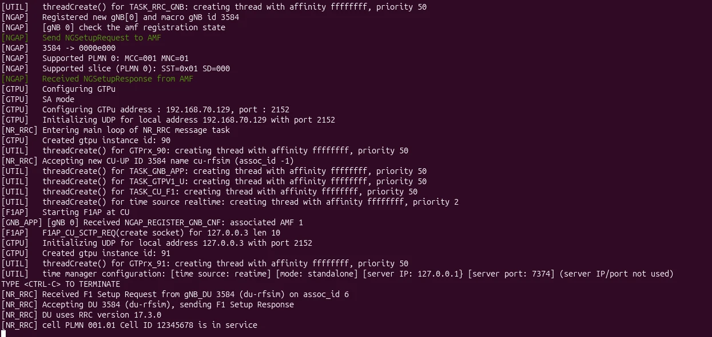
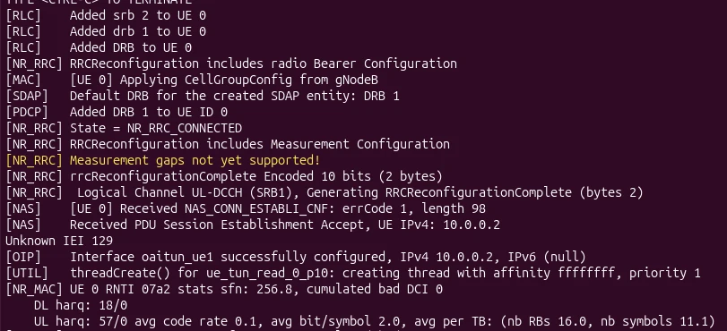
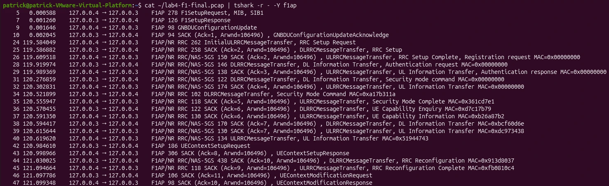
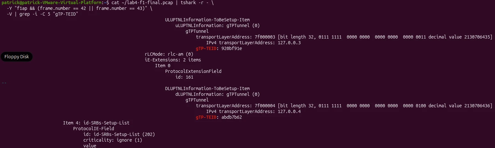
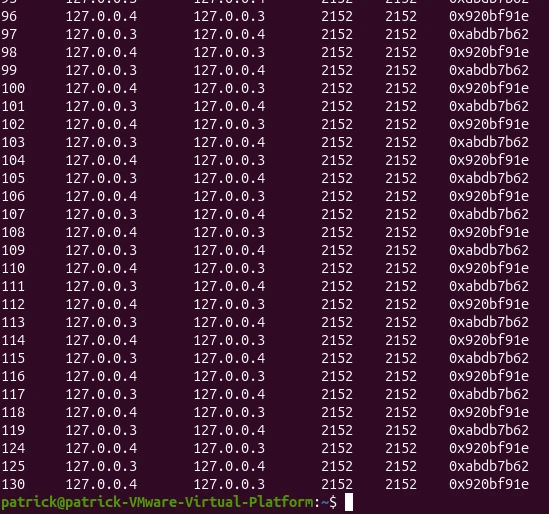
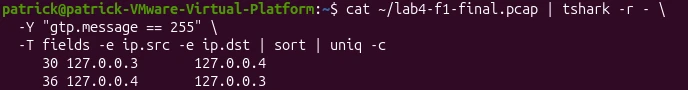

# Lab 4 — 5G CU/DU Split Deployment and F1-C/F1-U Analysis

**Student handout**  
**Environment:** Ubuntu 24.04 LTS · OpenAirInterface (OAI) v2.4.0 · RFsimulator · no SDR required  
**Prerequisite:** Lab 3 completed successfully (OAI CN5G, gNB, nrUE, UE tunnel and Ping)

> **Lab objective:** Replace the monolithic gNB from Lab 3 with a split gNB-CU and gNB-DU. Capture and analyze both **F1-C** (F1AP over SCTP) and **F1-U** (GTP-U over UDP) in a single PCAP file. Verify that the UE can still establish a PDU session and reach the external data network.
>
> **Instructor validation:** This lab's CU/DU split, F1 Setup, UE RRC signaling, UE Context procedures, GTP-U T-PDUs, and external-DN Ping were observed on the classroom OAI v2.4.0 environment. Exact IP addresses, frequencies and core network configuration must be checked on each student image.

### Student experiment information

The experiment was performed using **Ubuntu 26.04 in VMware**, rather than the recommended Ubuntu 24.04 environment.

The final configuration used:

- OpenAirInterface v2.4.0
- Four virtual CPU cores
- Approximately 5.2 GiB RAM
- OAI 5G Core with ten Docker containers
- One gNB-CU and one gNB-DU
- One nrUE using RFsimulator
- CU F1 IP: `127.0.0.3`
- DU F1 IP: `127.0.0.4`

The initial experiment encountered a UE Random Access failure when only two CPU cores were allocated. After increasing the VM allocation to four cores, UE registration, PDU Session Establishment, and end-to-end communication succeeded.

**Final experimental capture:** `lab4-f1-final.pcap`

This file replaces `lab4-f1-complete.pcap` from the preliminary attempt. The original handout commands remain below; where necessary, the final capture filename is specified separately.

---

## 1. Learning objectives

After completing this lab, you should be able to:

1. Explain the functional division between gNB-CU and gNB-DU.
2. Deploy a split 5G SA RAN with OAI and RFsimulator.
3. Identify **F1-C** control-plane messages (F1 Setup, RRC transfer, UE Context Setup).
4. Identify **F1-U** user-plane GTP-U packets, including their direction and TEID.
5. Verify UE IP connectivity through the split architecture.
6. Distinguish F1-U from the separate **N3** interface, even though both can use GTP-U.

### Student result

All six learning objectives were demonstrated or addressed through the experimental deployment, packet capture, traffic analysis, and written explanations.

The successful final capture contained F1AP signaling, UE Context procedures, and bidirectional GTP-U user-plane packets. End-to-end connectivity was independently confirmed with a successful ICMP Ping test.

---

## 2. Network architecture and experimental parameters

```text
                         OAI 5G Core
                     AMF / SMF / UPF
                           |
                   N2 (NGAP) / N3 (GTP-U)
                           |
                      +----------+
                      |  gNB-CU  |  F1-C IP: 127.0.0.3
                      | RRC/PDCP |  (example classroom setup)
                      +----------+
                         |     |
        F1-C: F1AP/SCTP |     | F1-U: GTP-U/UDP
                         |     |
                      +----------+
                      |  gNB-DU  |  F1 IP: 127.0.0.4
                      |RLC/MAC/PHY|
                      +----------+
                           |
                    RFsimulator (IQ/TCP)
                           |
                         nrUE
                           |
                      oaitun_ue1
                           |
                       ICMP Ping
```

| Parameter | Classroom configuration |
|---|---|
| OAI version | `v2.4.0` |
| RAN | One gNB-CU + one gNB-DU + one nrUE |
| Radio | RFsimulator, no physical SDR |
| NR band | n78 |
| Bandwidth | 106 PRBs |
| Numerology | 1 (30 kHz SCS) |
| CU F1 address (observed) | `127.0.0.3` |
| DU F1 address (observed) | `127.0.0.4` |
| DU SSB NR-ARFCN (observed) | `630048` (3,450.72 MHz) |
| UE frequency argument used in successful split test | `-C 3450720000` |
| UE IMSI | `001010000000001` |
| External DN | `192.168.70.135` |

**Important:** The Lab 3 monolithic gNB config used `absoluteFrequencySSB = 641280` (3,619.20 MHz), whereas the split DU config used `630048` (3,450.72 MHz). The frequency parameters **must match the working DU/UE pair**. Do not reuse Lab 3's `-C 3619200000` without checking the DU configuration. The `-C` argument and effective radio carrier placement should be verified against OAI startup logs; the above value is the one used in the successful classroom test, not a general formula for every DU file.

### Student verification

The configured CU and DU addresses matched the classroom configuration.

| Parameter | Observed result |
|---|---|
| CU F1 address | `127.0.0.3` |
| DU F1 address | `127.0.0.4` |
| DU SSB NR-ARFCN | `630048` |
| DU Point A | `628776` |
| DU bandwidth | `106 PRBs` |
| UE frequency argument | `3450720000 Hz` |
| UE IPv4 address after registration | `10.0.0.2` |

The selected DU and UE radio parameters were compatible, as confirmed by successful UE synchronization, registration, PDU Session Establishment, and Ping.

---

## 3. Task 1 — Inspect the split configurations

### Step 1. Confirm the configuration files exist

```bash
cd ~/openairinterface5g-v2.4.0

ls -l \
  targets/PROJECTS/GENERIC-NR-5GC/CONF/gnb-cu.sa.f1.conf \
  targets/PROJECTS/GENERIC-NR-5GC/CONF/gnb-du.sa.band78.106prb.rfsim.pci0.conf
```

### Step 2. Check frequency and F1 network settings

```bash
grep -nE \
'absoluteFrequencySSB|dl_absoluteFrequencyPointA|dl_carrierBandwidth|physCellId|min_rxtxtime|local_s_address|remote_s_address|local_n_address|remote_n_address|local_s_portd|remote_s_portd|local_n_portd|remote_n_portd|amf_ip_address' \
  targets/PROJECTS/GENERIC-NR-5GC/CONF/gnb-cu.sa.f1.conf \
  targets/PROJECTS/GENERIC-NR-5GC/CONF/gnb-du.sa.band78.106prb.rfsim.pci0.conf
```

**Record:** The CU and DU F1 addresses, the DU SSB frequency, and PRB count. If the local settings differ from the table above, adapt the following commands and capture filters accordingly.

### Student results — Configuration verification

Both configuration files were found.

The following parameters were verified:

| Configuration parameter | Observed value |
|---|---|
| CU local F1 address | `127.0.0.3` |
| DU local F1 address | `127.0.0.4` |
| DU remote F1 address | `127.0.0.3` |
| `absoluteFrequencySSB` | `630048` |
| `dl_absoluteFrequencyPointA` | `628776` |
| `dl_carrierBandwidth` | `106` |


*Figure 1: Verification of the CU/DU configuration files, IP addresses and radio parameters.*

**Questions**

1. Which protocol layers mainly reside in the CU, and which reside in the DU?
2. What is the purpose of the F1 interface?
3. Why must the UE radio frequency be compatible with the DU rather than taken blindly from the previous lab?

### Answers — Task 1

**1. Which protocol layers mainly reside in the CU, and which reside in the DU?**

The gNB-CU mainly contains the higher radio protocol layers, including RRC, PDCP and SDAP. The gNB-DU contains the lower layers, including RLC, MAC and PHY. The DU is responsible for lower-layer radio processing, while the CU handles higher-layer control and data processing.

**2. What is the purpose of the F1 interface?**

The F1 interface enables communication between the gNB-CU and gNB-DU. It is separated into F1-C for control-plane signaling and F1-U for user-plane traffic.

F1-C uses F1AP over SCTP. F1-U uses GTP-U over UDP.

This separation allows the CU and DU to operate as independent components while together providing the functionality of a gNB.

**3. Why must the UE radio frequency be compatible with the DU rather than taken blindly from the previous lab?**

The DU is responsible for radio transmission and reception. Therefore, the UE must use radio parameters compatible with the DU configuration to synchronize and communicate successfully.

Lab 3 used a different monolithic gNB frequency configuration. Reusing its UE frequency without verifying the DU settings could prevent synchronization and connection establishment.

In the successful Lab 4 deployment, the UE was started with `-C 3450720000`.

---

## 4. Task 2 — Deploy the split 5G SA network

Before starting, stop the monolithic Lab 3 gNB and any old nrUE processes with `Ctrl+C`. Avoid running two gNB/DU RFsimulator servers on the same listening port.

### Terminal 1 — Start CN5G

```bash
cd ~/oai-cn5g
docker compose up -d
docker compose ps
```

### Student result — CN5G

The OAI 5G Core was started successfully using Docker Compose.

All ten containers were running and displayed a healthy status during the final experiment.

The deployed services included AMF, SMF, UPF, AUSF, UDM, UDR, NRF, MySQL, IMS and the external data network.


*Figure 2: All ten OAI 5G Core containers running successfully.*

### Terminal 2 — Start gNB-CU

```bash
cd ~/openairinterface5g-v2.4.0/cmake_targets/ran_build/build

sudo ./nr-softmodem \
  -O ../../../targets/PROJECTS/GENERIC-NR-5GC/CONF/gnb-cu.sa.f1.conf
```

### Student result — gNB-CU

The CU started successfully and established a connection to the AMF.

The CU log contained:

```text
Send NGSetupRequest to AMF
Received NGSetupResponse from AMF
Starting F1AP at CU
F1AP_CU_SCTP_REQ(create socket) for 127.0.0.3
```

The GTP-U interface was also initialized on UDP port 2152.

### Terminal 3 — Start gNB-DU

**Start the packet capture in Task 3 *before* starting the DU if you want to record the initial F1 Setup handshake.**

```bash
cd ~/openairinterface5g-v2.4.0/cmake_targets/ran_build/build

sudo ./nr-softmodem \
  -O ../../../targets/PROJECTS/GENERIC-NR-5GC/CONF/gnb-du.sa.band78.106prb.rfsim.pci0.conf \
  --rfsim
```

### Student result — gNB-DU and F1 Setup

The DU successfully started and established the F1 connection with the CU.

The CU log confirmed:

```text
Received F1 Setup Request from gNB_DU 3584 (du-rfsim) on assoc_id 6
Accepting DU 3584 (du-rfsim), sending F1 Setup Response
DU uses RRC version 17.3.0
cell PLMN 001.01 Cell ID 12345678 is in service
```

A later network check also confirmed an established SCTP association between `127.0.0.3:38472` and the DU at `127.0.0.4`.



*Figure 3: CU terminal confirming successful F1 Setup between CU and DU.*

### Terminal 4 — Start nrUE

```bash
cd ~/openairinterface5g-v2.4.0/cmake_targets/ran_build/build

sudo ./nr-uesoftmodem \
  -r 106 \
  --numerology 1 \
  --band 78 \
  -C 3450720000 \
  --uicc0.imsi 001010000000001 \
  --rfsim \
  --rfsimulator.serveraddr 127.0.0.1
```

> **Instructor note:** This UE command reflects the working classroom split configuration. In particular, the original Lab 3 `-C 3619200000` setting was not compatible with this DU configuration. If a provided classroom image has different NR frequencies or UICC credentials, use the instructor-validated values.

### Student result — nrUE registration

The UE successfully synchronized with the DU and completed the connection procedure.

Relevant log messages included:

```text
Received NAS_DOWNLINK_DATA_IND type FGS_REGISTRATION_ACCEPT
Send NAS_UPLINK_DATA_REQ message(RegistrationComplete)
State = NR_RRC_CONNECTED
Received PDU Session Establishment Accept, UE IPv4: 10.0.0.2
Interface oaitun_ue1 successfully configured
```

This confirmed:

- Successful UE registration.
- Successful RRC connection establishment.
- Successful PDU Session Establishment.
- UE IPv4 address assignment.
- Successful UE tunnel configuration.



*Figure 4: Successful RRC connection, PDU Session Establishment and configuration of the UE tunnel.*

### Check the UE connection

```bash
ip -4 addr show oaitun_ue1
ping -I oaitun_ue1 -c 10 192.168.70.135
```

**Evidence:** Screenshots of CU/DU startup, UE connection, and successful Ping. Record the observed UE IP, transmitted/received packets, packet loss, and average RTT. Do **not** invent values; they vary by machine.

### Student result — UE IP and end-to-end Ping

The UE tunnel interface was successfully configured:

```text
inet 10.0.0.2/24 scope global oaitun_ue1
```

The Ping test returned:

```text
10 packets transmitted, 10 received, 0% packet loss

rtt min/avg/max/mdev =
18.501/23.084/29.739/2.985 ms
```

| Measurement | Observed result |
|---|---|
| UE interface | `oaitun_ue1` |
| UE IPv4 | `10.0.0.2` |
| Destination | `192.168.70.135` |
| ICMP packets transmitted | 10 |
| ICMP packets received | 10 |
| Packet loss | **0%** |
| Minimum RTT | 18.501 ms |
| Average RTT | **23.084 ms** |
| Maximum RTT | 29.739 ms |
| RTT mdev | 2.985 ms |

The successful Ping confirmed end-to-end connectivity between the UE and external data network.


*Figure 5: Successful UE tunnel and end-to-end Ping with 0% packet loss.*

During the final PCAP capture, an additional 30-packet Ping was started to generate user-plane traffic. Responses were observed while the capture was running. The completed 10-packet test above provides the recorded final RTT and packet-loss statistics.

---

## 5. Task 3 — Capture F1-C and F1-U in a single PCAP

The classroom capture showed CU `127.0.0.3` and DU `127.0.0.4` on the Linux loopback interface (`lo`).

### Step 1. Start packet capture

Start CN5G and CU, but **before starting the DU** open another terminal:

```bash
sudo tcpdump -i lo -s 0 -nn \
  -w ~/lab4-f1-complete.pcap \
  'host 127.0.0.3 and host 127.0.0.4 and (sctp or udp port 2152)'
```

This captures:

- **F1-C:** F1AP carried over SCTP.
- **F1-U:** GTP-U carried over UDP port 2152, **provided the configured F1-U endpoints and port match these values**.

### Step 2. Trigger control-plane and user-plane traffic

1. Start the DU to trigger **SCTP association** and **F1 Setup**.
2. Start nrUE to trigger **RRC** and **UE Context** procedures.
3. After the UE tunnel appears, generate traffic:

```bash
ping -I oaitun_ue1 -c 30 -i 0.2 192.168.70.135
```

4. Press `Ctrl+C` in the **tcpdump terminal** to finish and save the PCAP.
5. Verify the file:

```bash
ls -lh ~/lab4-f1-complete.pcap
```

### Alternative: capture all traffic between CU and DU

If you are unsure of the F1-U UDP port, use this **instead of** the filtered capture above:

```bash
sudo tcpdump -i lo -s 0 -nn \
  -w ~/lab4-f1-all.pcap \
  'host 127.0.0.3 and host 127.0.0.4'
```

If the CU and DU are not communicating over `lo`, select the correct interface (`ip -br addr` or `tcpdump -D`) and update the IP filter.

### Student results — Final F1-C/F1-U capture

The first experimental capture was saved as `lab4-f1-complete.pcap`, but it contained only the early connection attempts and no F1-U user-plane traffic.

After resolving the UE connection issue, a second capture was performed.

**The final submission uses `lab4-f1-final.pcap`.**

The final capture command was:

```bash
sudo tcpdump -i lo -s 0 -nn \
  -w ~/lab4-f1-final.pcap \
  'host 127.0.0.3 and host 127.0.0.4 and (sctp or udp port 2152)'
```

The capture started before the DU and nrUE.

It therefore included:

- SCTP signaling for F1-C.
- F1 Setup Request and Response.
- RRC Setup and Registration signaling.
- UE Context Setup and Modification.
- GTP-U user-plane traffic in both directions.

After the test, tcpdump reported:

```text
134 packets captured
268 packets received by filter
0 packets dropped by kernel
```

| Capture property | Observed result |
|---|---|
| Interface | `lo` |
| Filename | `lab4-f1-final.pcap` |
| Captured packets | **134** |
| Packets received by filter | 268 |
| Kernel packet drops | **0** |
| F1-C present | Yes |
| F1-U present | Yes |

The higher received-by-filter count is a tcpdump capture statistic and should not be interpreted as 268 unique saved packets.


*Figure 6: Final tcpdump capture with 134 saved packets and zero kernel drops.*

For the remaining analyses, the successful final capture was used.

---

## 6. Task 4 — Analyze F1-C (F1AP / SCTP)

Open the capture:

```bash
wireshark ~/lab4-f1-complete.pcap
```

**Student note:** The final successful capture is `~/lab4-f1-final.pcap`. This file was used for the final analyses instead of the preliminary capture named in the original command.

Useful **Wireshark display filters**:

```text
sctp
f1ap
```

Find and record these messages:

| Message | Typical direction | Meaning |
|---|---|---|
| SCTP INIT / INIT_ACK / COOKIE_ECHO / COOKIE_ACK | DU ↔ CU | Establish SCTP association |
| F1 Setup Request | DU → CU | DU initiates F1 connection and provides served-cell information |
| F1 Setup Response | CU → DU | CU accepts F1 Setup |
| GNBDUConfigurationUpdate | DU → CU | DU informs CU of configuration changes |
| Initial UL RRC Message Transfer (RRC Setup Request) | DU → CU | UE initial RRC request forwarded to CU |
| DL RRC Message Transfer (RRC Setup) | CU → DU | CU delivers RRC Setup toward UE |
| UL RRC Message Transfer (RRC Setup Complete) | DU → CU | UE completes RRC procedure; NAS Registration Request can be carried inside |
| UE Context Setup Request / Response | CU ↔ DU | Establish UE-specific resources/context |
| DL RRC Message Transfer (RRC Reconfiguration) | CU → DU | CU sends further RRC configuration |

**Observed classroom sequence:** The successful capture contained SCTP association, F1 Setup Request/Response, DU Configuration Update/Acknowledgement, RRC Setup messages, Authentication signaling carried through RRC, UE Context Setup/Modification, and RRC Reconfiguration. The exact packet numbers and timing are **not fixed**.

### Student results — F1-C packet analysis

The final capture was analyzed with:

```bash
cat ~/lab4-f1-final.pcap | tshark -r - -Y f1ap
```

### A. F1 Setup and DU configuration

| Packet | Source | Destination | Message |
|---|---|---|---|
| 5 | `127.0.0.4` | `127.0.0.3` | F1SetupRequest |
| 7 | `127.0.0.3` | `127.0.0.4` | F1SetupResponse |
| 9 | `127.0.0.4` | `127.0.0.3` | GNBDUConfigurationUpdate |
| 10 | `127.0.0.3` | `127.0.0.4` | GNBDUConfigurationUpdateAcknowledge |

The DU initiated the F1 Setup procedure.

The CU accepted the connection and returned an F1 Setup Response.

The subsequent DU Configuration Update and Acknowledgement demonstrated additional signaling over the established F1 interface.


*Figure 7: F1 Setup Request and Response observed between DU and CU.*

### B. UE RRC and NAS signaling

The final capture contained the following UE-related signaling:

| Packet | Direction | Message |
|---|---|---|
| 24 | DU → CU | InitialULRRCMessageTransfer, RRC Setup Request |
| 25 | CU → DU | DLRRCMessageTransfer, RRC Setup |
| 26 | DU → CU | ULRRCMessageTransfer, RRC Setup Complete, Registration Request |
| 28 | CU → DU | DLRRCMessageTransfer, DL Information Transfer, Authentication Request |
| 29 | DU → CU | ULRRCMessageTransfer, UL Information Transfer, Authentication Response |
| 31 | CU → DU | DLRRCMessageTransfer, DL Information Transfer, Security Mode Command |
| 34 | CU → DU | DLRRCMessageTransfer, Security Mode Command |
| 35 | DU → CU | ULRRCMessageTransfer, Security Mode Complete |
| 36 | CU → DU | DLRRCMessageTransfer, UE Capability Enquiry |
| 37 | DU → CU | ULRRCMessageTransfer, UE Capability Information |
| 44 | CU → DU | DLRRCMessageTransfer, RRC Reconfiguration |
| 45 | DU → CU | ULRRCMessageTransfer, RRC Reconfiguration Complete |

In packet 26, the Registration Request was visible together with RRC Setup Complete.

This demonstrates that NAS signaling can be transported within RRC messages and forwarded through the F1-C interface.


*Figure 8: F1AP messages associated with RRC Setup, NAS Registration, authentication and subsequent RRC procedures.*

### C. UE Context Setup and Modification

The following procedures were captured:

| Packet | Source | Destination | Message |
|---|---|---|---|
| 42 | `127.0.0.3` | `127.0.0.4` | UEContextSetupRequest |
| 43 | `127.0.0.4` | `127.0.0.3` | UEContextSetupResponse |
| 46 | `127.0.0.3` | `127.0.0.4` | UEContextModificationRequest |
| 47 | `127.0.0.4` | `127.0.0.3` | UEContextModificationResponse |

The CU initiated UE Context Setup and Modification procedures, and the DU responded.

These messages configure UE-specific resources and transport information between the CU and DU.



*Figure 9: UE Context Setup and UE Context Modification procedures captured over F1-C.*

### D. F1-U tunnel parameters in F1-C

The UE Context Setup signaling also contained GTP-U tunnel parameters.

The following command was used:

```bash
cat ~/lab4-f1-final.pcap | tshark -r - \
  -Y "f1ap && (frame.number == 42 || frame.number == 43)" \
  -V | grep -i -C 5 "gTP-TEID"
```

The decoded information included:

**Uplink transport information**

```text
ULUPTNLInformation-ToBeSetup-Item
uLUPTNLInformation: gTPtunnel
IPv4 transportLayerAddress: 127.0.0.3
gTP-TEID: 920bf91e
```

**Downlink transport information**

```text
DLUPTNLInformation-ToBeSetup-Item
dLUPTNLInformation: gTPtunnel
IPv4 transportLayerAddress: 127.0.0.4
gTP-TEID: abdb7b62
```

| Direction | Receiving tunnel endpoint | TEID |
|---|---|---|
| Uplink | CU `127.0.0.3` | `0x920bf91e` |
| Downlink | DU `127.0.0.4` | `0xabdb7b62` |

The observed TEIDs matched those in the subsequent F1-U traffic.

This provides direct evidence that F1-C signaling configured the tunnel endpoints used for F1-U user-plane communication.



*Figure 10: F1AP UE Context signaling showing uplink and downlink transport addresses and TEIDs.*

**Questions**

1. Which node initiates F1 Setup, and which acknowledges it?
2. Explain the difference between SCTP association establishment and F1 Setup.
3. How can a NAS Registration Request be transported over F1-C?
4. What is the role of UE Context Setup?
5. Does F1 Setup alone prove successful UE Registration? Explain.

### Answers — Task 4

**1. Which node initiates F1 Setup, and which acknowledges it?**

The gNB-DU initiates F1 Setup by sending an F1SetupRequest to the gNB-CU. The CU acknowledges and accepts the procedure by sending an F1SetupResponse.

This was confirmed by packets 5 and 7.

**2. Explain the difference between SCTP association establishment and F1 Setup.**

SCTP association establishment creates a transport-layer connection between CU and DU.

The SCTP handshake uses INIT, INIT_ACK, COOKIE_ECHO and COOKIE_ACK.

F1 Setup is an application-layer procedure carried over the established SCTP association. It exchanges information about the CU/DU connection and served cells.

Therefore, SCTP connectivity must be available before F1AP signaling can be exchanged, but an established SCTP association does not by itself prove that F1 Setup succeeded.

**3. How can a NAS Registration Request be transported over F1-C?**

The UE sends its NAS Registration Request encapsulated in an RRC message.

The DU forwards the corresponding RRC message to the CU using F1AP over F1-C.

The CU extracts and processes the higher-layer signaling and forwards NAS information toward the AMF through NGAP.

In packet 26, the capture showed RRC Setup Complete together with the Registration Request.

**4. What is the role of UE Context Setup?**

UE Context Setup establishes UE-specific resources and configuration in the DU under CU control.

These can include UE identifiers, radio bearer information, radio configuration, and user-plane tunnel parameters.

In this experiment, the UE Context messages also exposed the F1-U GTP-U tunnel addresses and TEIDs.

**5. Does F1 Setup alone prove successful UE Registration? Explain.**

No. F1 Setup only establishes the interface between the CU and DU.

Successful UE Registration additionally requires synchronization, Random Access, RRC connection establishment, NAS signaling and successful communication with the 5G Core.

The initial experiment demonstrated this distinction: F1 Setup succeeded even though UE registration failed.

Only the later successful UE logs and Ping test confirmed full connectivity.

**Evidence:** Screenshot with F1 Setup Request/Response and screenshot with at least three UE-associated F1AP messages. Include packet numbers and source/destination addresses.

**Student evidence:** Figures 7–10 show the F1 Setup procedure, UE-associated F1AP signaling, UE Context procedures, and user-plane tunnel configuration.

---

## 7. Task 5 — Analyze F1-U (GTP-U / UDP)

In the **same PCAP**, apply:

```text
gtp
```

If necessary, first check:

```text
udp.port == 2152
```

Directional display filters (based on the observed classroom CU/DU IP pair):

```text
gtp && ip.src == 127.0.0.4 && ip.dst == 127.0.0.3
gtp && ip.src == 127.0.0.3 && ip.dst == 127.0.0.4
```

In the captured GTP-U packet details, inspect:

```text
Internet Protocol (outer CU/DU addresses)
  User Datagram Protocol
    GPRS Tunneling Protocol (GTP-U)
      Message Type: G-PDU / T-PDU
      Tunnel Endpoint Identifier (TEID)
      Encapsulated user payload (if decodable)
```

**Important:** The classroom trace showed repeated `GTP T-PDU` packets from `127.0.0.4` (DU) to `127.0.0.3` (CU), confirming traffic on the CU–DU user-plane path. The actual TEID was **not recorded** in the provided screenshot: read the TEID from your own packet details instead of assuming a value.

### Student results — F1-U analysis

The successful capture `lab4-f1-final.pcap` contained bidirectional GTP-U traffic.

The following command was used to extract GTP-U packets and their tunnel identifiers:

```bash
cat ~/lab4-f1-final.pcap | tshark -r - -Y "gtp" \
  -T fields -e frame.number -e ip.src -e ip.dst \
  -e udp.srcport -e udp.dstport -e gtp.teid
```

### A. Uplink: DU → CU

| Field | Observed value |
|---|---|
| Source IP | `127.0.0.4` |
| Destination IP | `127.0.0.3` |
| Source UDP port | `2152` |
| Destination UDP port | `2152` |
| TEID | `0x920bf91e` |
| Example packet | 49 |

The uplink packets were sent from the DU toward the CU.

The TEID identifies the receiving tunnel endpoint in the CU.


*Figure 11: F1-U uplink packets from DU to CU, including UDP port 2152 and TEID 0x920bf91e.*

### B. Downlink: CU → DU

| Field | Observed value |
|---|---|
| Source IP | `127.0.0.3` |
| Destination IP | `127.0.0.4` |
| Source UDP port | `2152` |
| Destination UDP port | `2152` |
| TEID | `0xabdb7b62` |
| Example packet | 62 |

The downlink packets were sent from the CU toward the DU.

The TEID identifies the receiving tunnel endpoint in the DU.



*Figure 12: F1-U traffic showing downlink packets from CU to DU and TEID 0xabdb7b62.*

### C. GTP-U T-PDU verification

To identify GTP-U data packets, the following command was used:

```bash
cat ~/lab4-f1-final.pcap | tshark -r - \
  -Y "gtp.message == 255" \
  -T fields -e frame.number -e ip.src -e ip.dst \
  -e gtp.teid -e gtp.length | head -20
```

GTP-U message type `255` corresponds to a G-PDU carrying a T-PDU.

Selected observed packets:

| Packet | Source | Destination | TEID | GTP length |
|---|---|---|---|---:|
| 49 | `127.0.0.4` | `127.0.0.3` | `0x920bf91e` | 51 |
| 50 | `127.0.0.4` | `127.0.0.3` | `0x920bf91e` | 51 |
| 61 | `127.0.0.4` | `127.0.0.3` | `0x920bf91e` | 87 |
| 62 | `127.0.0.3` | `127.0.0.4` | `0xabdb7b62` | 99 |
| 63 | `127.0.0.4` | `127.0.0.3` | `0x920bf91e` | 87 |
| 64 | `127.0.0.3` | `127.0.0.4` | `0xabdb7b62` | 99 |

These packets confirmed that the F1-U interface transported encapsulated user-plane data.


*Figure 13: GTP-U G-PDUs with packet numbers, outer addresses, TEIDs and GTP payload lengths.*

### D. Uplink and downlink packet counts

The GTP-U packets were counted using:

```bash
cat ~/lab4-f1-final.pcap | tshark -r - \
  -Y "gtp.message == 255" \
  -T fields -e ip.src -e ip.dst | sort | uniq -c
```

Observed output:

```text
30 127.0.0.3 127.0.0.4
36 127.0.0.4 127.0.0.3
```

| Direction | Source | Destination | G-PDUs |
|---|---|---|---:|
| Uplink | DU | CU | **36** |
| Downlink | CU | DU | **30** |
| **Total** | | | **66** |

The capture contained **66 GTP-U G-PDUs** in both directions.

The packet counts are not equal. This does not necessarily indicate packet loss because the capture counts all matching GTP-U packets, not only the ICMP Echo Requests and Replies.



*Figure 14: TShark results showing 36 uplink and 30 downlink GTP-U packets.*

### E. TEID and tunnel endpoint consistency

The observed tunnel identifiers were:

| Direction | TEID | Receiving endpoint |
|---|---|---|
| Uplink | `0x920bf91e` | `127.0.0.3` (CU) |
| Downlink | `0xabdb7b62` | `127.0.0.4` (DU) |

These values were consistent with the GTP-U tunnel configuration carried in the UE Context Setup signaling described in Task 4.

This provides evidence that the F1-C procedures successfully established the user-plane tunnel configuration later used by F1-U.

### Distinguish F1-U from N3

Both **F1-U** and **N3** can use GTP-U. Do **not** classify traffic as F1-U solely because Wireshark says `GTP` or the port is `2152`.

- **F1-U:** GTP-U between **gNB-DU and gNB-CU**.
- **N3:** GTP-U between **gNB-CU and 5GC UPF**.

Identify the interface using the actual source/destination endpoints and configuration.

### Student analysis — F1-U vs N3

The recorded GTP-U packets used:

```text
127.0.0.4 <-> 127.0.0.3
```

These addresses correspond to the DU and CU F1 interfaces.

Therefore, the recorded packets were classified as **F1-U**, not N3.

N3 also uses GTP-U but connects the RAN to the UPF in the 5G Core. It must be distinguished by checking the source and destination endpoints rather than only the GTP-U protocol.

**Questions**

1. Which transport protocol carries F1-U?
2. What does a GTP-U **TEID** identify?
3. Which direction is `127.0.0.4 → 127.0.0.3` in this setup?
4. How would you distinguish F1-U from N3 in a packet capture?
5. Why do F1-C and F1-U use different transport protocols?

### Answers — Task 5

**1. Which transport protocol carries F1-U?**

F1-U uses GTP-U encapsulation over UDP. In this experiment, UDP port 2152 was used.

**2. What does a GTP-U TEID identify?**

The Tunnel Endpoint Identifier identifies a specific GTP-U tunnel endpoint at the receiver.

It allows incoming GTP-U packets to be assigned to the correct user-plane tunnel and corresponding radio bearer context.

Different TEIDs may be used for uplink and downlink directions.

**3. Which direction is `127.0.0.4 → 127.0.0.3` in this setup?**

`127.0.0.4` is the DU and `127.0.0.3` is the CU.

Therefore, this is the **uplink direction**, from DU to CU.

The observed uplink TEID was `0x920bf91e`.

**4. How would you distinguish F1-U from N3 in a packet capture?**

Both interfaces may use GTP-U over UDP port 2152.

The correct interface must be identified using the actual network endpoints.

F1-U connects the DU and CU, while N3 connects the RAN to the UPF.

In this experiment, packets exchanged between `127.0.0.4` and `127.0.0.3` were F1-U packets.

**5. Why do F1-C and F1-U use different transport protocols?**

F1-C carries control-plane messages that require reliable signaling and association management. Therefore, it uses F1AP over SCTP.

F1-U carries user-plane packets and uses GTP-U over UDP for efficient tunneling and forwarding.

The protocols were selected to support the different requirements of control-plane signaling and user-plane traffic.

**Evidence:** Screenshot of at least one GTP-U T-PDU, with outer IP addresses, UDP ports, message type, and TEID visible. Record the observed UL and DL packet counts (if both directions are present). Do not assume equal counts.

**Student evidence:** Figures 11–14 document the observed uplink/downlink traffic, TEIDs, GTP-U G-PDUs, and directional packet counts.

---

## 8. Task 6 — Compare monolithic and split gNB

Complete the table:

| Feature | Lab 3: Monolithic gNB | Lab 4: CU/DU Split |
|---|---|---|
| Number of RAN processes | | |
| Location of RRC/PDCP | | |
| Location of RLC/MAC/PHY | | |
| F1-C interface present? | | |
| F1-U interface present? | | |
| UE connected to the same 5GC? | | |
| End-to-end Ping works? | | |

### Student answer — Completed comparison

| Feature | Lab 3: Monolithic gNB | Lab 4: CU/DU Split |
|---|---|---|
| Number of RAN processes | One gNB process | Two gNB processes: CU and DU |
| Location of RRC/PDCP | Monolithic gNB | gNB-CU |
| Location of RLC/MAC/PHY | Monolithic gNB | gNB-DU |
| F1-C interface present? | No | Yes, F1AP/SCTP |
| F1-U interface present? | No | Yes, GTP-U/UDP |
| UE connected to the same 5GC? | Same OAI CN5G environment | Same OAI CN5G environment |
| End-to-end Ping works? | Not verified in the recorded Lab 3 result | Yes, 0% loss in Lab 4 |

Explain in **3–5 sentences** why splitting a gNB changes the internal RAN interfaces but does not change the UE's need for synchronization, registration and a PDU session.

### Student explanation

Splitting the gNB separates higher-layer functions in the CU from lower-layer radio functions in the DU, introducing the F1-C and F1-U interfaces between them. F1-C exchanges control signaling, while F1-U transports user-plane data between these units. However, the UE must still synchronize with the radio cell, complete Random Access and RRC connection establishment, and register with the 5G Core. A PDU Session is also required before the UE can exchange user-plane data with the external network. Therefore, the CU/DU split changes the internal RAN architecture but does not remove the essential UE connection procedures.

---

## 9. Troubleshooting

| Symptom | First checks |
|---|---|
| DU cannot establish F1 Setup | CU running; CU/DU F1 IP and ports; SCTP association; `f1ap` capture |
| UE repeatedly fails to decode SIB1 | Verify DU `absoluteFrequencySSB` and UE `-C`; check PHY/MAC synchronization and DU logs |
| UE syncs but Registration fails | Check CU/AMF logs, subscriber credentials (IMSI/key/OPc), RRC/NAS progress |
| UE attaches but no `oaitun_ue1` | Check PDU Session Establishment, 5GC SMF/UPF and UE logs |
| Ping fails | Confirm the tunnel, external DN reachability, routing, and user-plane path |
| Only F1AP appears in PCAP | Run Ping; verify PDU session; verify F1-U endpoints/port and capture interface |
| GTP appears but could be N3 | Check source/destination IPs against DU, CU and UPF addresses |
| Wireshark does not decode UDP 2152 as GTP-U | Examine UDP payload and optionally use **Analyze → Decode As…** |

**Do not** assume a screenshot of F1 Setup proves that UE Registration and end-to-end connectivity have succeeded. Validate each stage separately.

### Student troubleshooting experience

#### Problem 1 — UE Random Access failure

During the first experiment, the UE synchronized successfully and decoded SIB1, but Random Access did not complete.

The UE eventually terminated with:

```text
Assertion (len > 0) failed!
In fill_msg3_pdu_from_rlc()
no data for Msg3/MsgA_PUSCH
Aborted (core dumped)
```

At that time, the VM had only two allocated virtual CPU cores.

The initial packet capture contained F1-C signaling but no user-plane GTP-U packets.

#### Solution — Increase VM CPU resources

The VMware configuration was changed from two to four virtual CPU cores.

After restarting Ubuntu, the configuration was verified using:

```bash
nproc
free -h
```

The system reported four CPU cores and approximately 5.2 GiB RAM.

The 5G Core, CU, DU and nrUE were then restarted.

This time, UE Registration and PDU Session Establishment succeeded, and the UE obtained IP address `10.0.0.2`.

The successful result suggests that CPU resource availability was a contributing factor. However, the exact root cause of the initial failure was not conclusively established.

#### Problem 2 — Missing F1-U packets

The preliminary PCAP showed F1AP messages but no GTP-U packets on UDP port 2152.

This was consistent with the UE failing before PDU Session Establishment.

After the successful UE connection, a new capture was started before the DU and UE, followed by an ICMP Ping test.

The resulting PCAP contained 66 GTP-U G-PDUs.

#### Problem 3 — TShark file access

TShark initially reported a permission error when opening the PCAP directly.

The issue was bypassed using standard input:

```bash
cat ~/lab4-f1-final.pcap | tshark -r - -Y f1ap
```

This allowed the F1AP messages to be decoded and analyzed successfully.

### Final troubleshooting outcome

The final experiment successfully demonstrated:

- F1 Setup.
- UE RRC connection establishment.
- NAS Registration.
- UE Context Setup and Modification.
- PDU Session Establishment.
- End-to-end Ping.
- F1-U GTP-U traffic in both directions.

---

## 10. Submission checklist

Submit **one Markdown or PDF report** and **one PCAP file** containing:

- [x] CU/DU configuration summary and frequency check.
- [x] CU/DU and nrUE running evidence.
- [x] UE tunnel IP and successful Ping result (loss and RTT).
- [x] One PCAP containing **F1-C and F1-U**.
- [x] F1 Setup Request/Response screenshot.
- [x] Three or more UE-related F1AP messages with explanation.
- [x] At least one GTP-U T-PDU screenshot with TEID and endpoints.
- [x] Explanation distinguishing F1-C, F1-U and N3.
- [x] Completed monolithic-vs-split comparison table.
- [x] Answers to all analysis questions.

All screenshots, packet numbers, TEIDs and measurements must come from **your own experiment**.

### Student submission summary

| Requirement | Observed result |
|---|---|
| CU/DU F1 Setup | Successful |
| UE Registration | Successful |
| UE Context Setup | Packets 42 and 43 |
| UE Context Modification | Packets 46 and 47 |
| UE IPv4 | `10.0.0.2` |
| Ping | 10 transmitted, 10 received |
| Packet loss | 0% |
| Average RTT | 23.084 ms |
| F1-C transport | F1AP/SCTP |
| F1-U transport | GTP-U/UDP |
| Uplink TEID | `0x920bf91e` |
| Downlink TEID | `0xabdb7b62` |
| Uplink G-PDUs | 36 |
| Downlink G-PDUs | 30 |
| Total G-PDUs | 66 |
| Captured packets | 134 |
| Kernel packet drops | 0 |
| Final PCAP | `lab4-f1-final.pcap` |

### Submission file structure

```text
Lab4/
├── Lab4.md
├── lab4-f1-final.pcap
└── images/
    ├── task1-configuration.png
    ├── task2-cn5g.png
    ├── task2-cu-du-setup.png
    ├── task2-nrue-success.png
    ├── task2-ping-success.png
    ├── task3-tcpdump-final.png
    ├── task4-f1-setup.png
    ├── task4-rrc-registration.png
    ├── task4-ue-context.png
    ├── task4-ue-context-teids.png
    ├── task5-gtpu-teids-ul.png
    ├── task5-gtpu-teids-dl.png
    ├── task5-gtpu-gpdu.png
    └── task5-gtpu-count.png
```

---

## 11. Suggested grading rubric

| Category | Points |
|---|---:|
| Correct CU/DU deployment and parameter verification | 20 |
| F1-C capture and F1 Setup analysis | 20 |
| RRC/UE Context messages over F1-C | 20 |
| F1-U GTP-U and TEID analysis | 20 |
| UE tunnel and end-to-end Ping | 10 |
| Monolithic vs split comparison and report quality | 10 |
| **Total** | **100** |

### Student completion status

The final experiment produced supporting evidence for all six grading categories.

The CU/DU deployment was successful, and the final capture provided evidence of F1AP signaling, UE-associated RRC messages, UE Context procedures, and bidirectional F1-U traffic.

Successful UE registration, PDU Session Establishment, and end-to-end connectivity were also verified.

The actual grade depends on the instructor's evaluation of the report and submitted evidence.

---

## 12. Stop the experiment

Stop nrUE, DU and CU with `Ctrl+C`. Then stop CN5G:

```bash
cd ~/oai-cn5g
docker compose down
```

**Takeaway:** In the same OAI 5G SA network, **F1-C** exchanges RAN control signaling between CU and DU using **F1AP/SCTP**, while **F1-U** transports UE user-plane data between CU and DU using **GTP-U/UDP**. A successful UE Ping validates the end-to-end data path, while the PCAP shows what happens on the internal split-RAN interface.

### Student conclusion

The experiment successfully demonstrated a functional OAI v2.4.0 CU/DU split architecture using RFsimulator.

The CU and DU established the F1 interface, and F1AP signaling was captured throughout UE connection establishment. The capture also showed UE Context Setup and Modification, including the GTP-U tunnel parameters used for F1-U communication.

After improving the virtual machine's CPU allocation, the UE successfully registered and established a PDU Session with IPv4 address `10.0.0.2`.

The end-to-end Ping test achieved **0% packet loss** with an average RTT of **23.084 ms**.

The final PCAP contained **134 packets**, including **66 GTP-U G-PDUs** in both directions. The observed uplink TEID was `0x920bf91e`, and the downlink TEID was `0xabdb7b62`.

These observations confirm that F1-C manages the CU/DU control-plane procedures and user-plane tunnel configuration, while F1-U transports the actual user-plane packets.

The experiment therefore fulfilled the central objective of deploying a split 5G RAN and analyzing both F1 interfaces in the same successful end-to-end network.
