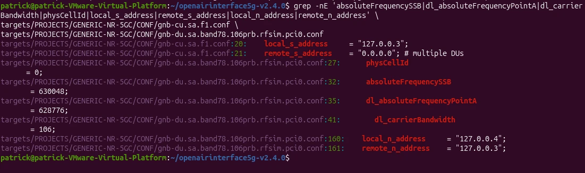
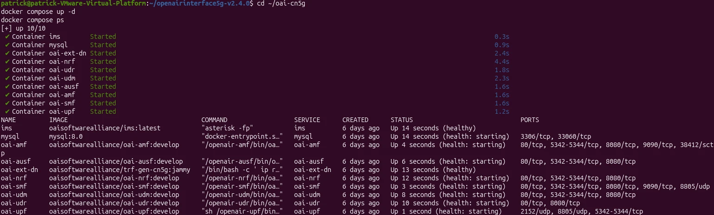
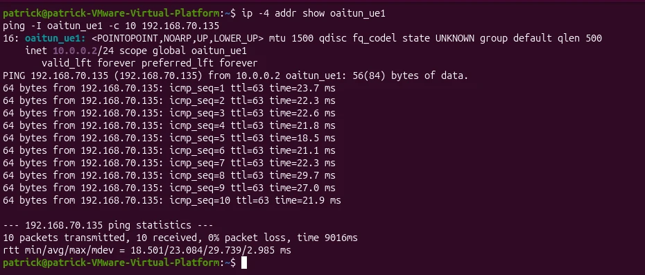
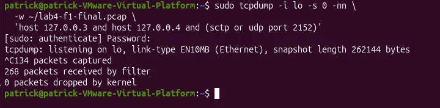
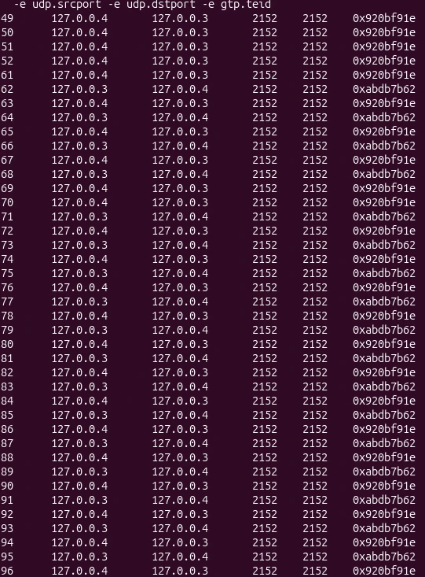
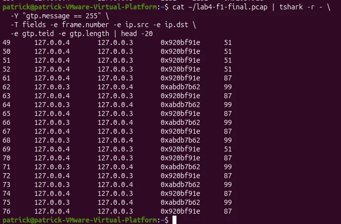

# Lab 4 — OpenAirInterface CU/DU Split and F1 Interface Analysis

**Course:** 5G Communication Systems Laboratory  
**Software:** OpenAirInterface v2.4.0  
**Operating System:** Ubuntu 26.04 (VMware)  
**Network:** OAI 5G Core + gNB-CU + gNB-DU + nrUE  
**Radio Environment:** RFsimulator

---

## 1. Introduction

The objective of this laboratory was to deploy and analyze a 5G Standalone (SA) network using a split gNB architecture.

Unlike the monolithic gNB deployed in Lab 3, this architecture separates the radio access network into a Central Unit (CU) and a Distributed Unit (DU).

The experiment focused on:

1. Configuring and deploying a split gNB architecture.
2. Establishing the F1 interface between the CU and DU.
3. Capturing F1-C signaling using SCTP and F1AP.
4. Analyzing RRC signaling and UE Context procedures.
5. Capturing F1-U user-plane traffic using GTP-U.
6. Identifying and comparing uplink and downlink TEIDs.
7. Establishing a successful UE connection and performing end-to-end connectivity tests.
8. Comparing the monolithic and split gNB architectures.

The experiment was performed using OAI v2.4.0 and a VMware Ubuntu virtual machine.

The initial attempt experienced a UE Random Access failure. After increasing the number of virtual CPU cores from two to four, the UE successfully registered with the network, established a PDU Session, and exchanged user-plane traffic.

---

## 2. Network Architecture

The deployed network consisted of the OAI 5G Core, gNB-CU, gNB-DU and nrUE.

### Architecture

```text
                    OAI 5G Core
                  +-------------+
                  | AMF / SMF   |
                  | UPF / AUSF  |
                  | UDM / UDR   |
                  +-------------+
                         |
                     N2 / N3
                         |
                  +-------------+
                  |   gNB-CU    |
                  | RRC / PDCP  |
                  | 127.0.0.3   |
                  +-------------+
                         |
                F1-C           F1-U
             F1AP/SCTP       GTP-U/UDP
                         |
                  +-------------+
                  |   gNB-DU    |
                  | RLC/MAC/PHY |
                  | 127.0.0.4   |
                  +-------------+
                         |
                    RFsimulator
                         |
                  +-------------+
                  |    nrUE     |
                  | 10.0.0.2    |
                  +-------------+
                         |
                    oaitun_ue1
                         |
                External Data Network
                  192.168.70.135
```

### CU and DU Functional Split

The gNB-CU is responsible for higher-layer radio functions, particularly RRC, PDCP and SDAP.

The gNB-DU handles the lower radio protocol layers, including RLC, MAC and PHY.

The F1 interface connects these two units.

**F1-C** transports control-plane signaling using F1AP over SCTP.

**F1-U** transports user-plane traffic using GTP-U over UDP.

### Experimental Parameters

| Parameter | Value |
|---|---|
| OAI version | v2.4.0 |
| Operating system | Ubuntu 26.04 |
| Virtualization | VMware |
| Allocated CPU cores | 4 |
| Virtual memory | 5.2 GiB |
| CU IP address | 127.0.0.3 |
| DU IP address | 127.0.0.4 |
| F1-C transport | SCTP |
| F1-C port | 38472 |
| F1-U transport | GTP-U over UDP |
| F1-U port | 2152 |
| NR band | n78 |
| Carrier bandwidth | 106 PRBs |
| Numerology | 1 |
| Subcarrier spacing | 30 kHz |
| DU absoluteFrequencySSB | 630048 |
| DU dl_absoluteFrequencyPointA | 628776 |
| UE frequency argument | 3450720000 Hz |
| UE IMSI | 001010000000001 |
| UE IPv4 address | 10.0.0.2 |
| External DN IPv4 | 192.168.70.135 |

---

## 3. Task 1 — Configuration Verification

### Objective

Verify that the CU and DU configuration files exist and that the F1 interface parameters are correctly configured.

### Configuration Files

The following OAI configuration files were used:

**CU:**

```text
targets/PROJECTS/GENERIC-NR-5GC/CONF/gnb-cu.sa.f1.conf
```

**DU:**

```text
targets/PROJECTS/GENERIC-NR-5GC/CONF/gnb-du.sa.band78.106prb.rfsim.pci0.conf
```

### Verification

```bash
cd ~/openairinterface5g-v2.4.0

ls -l \
  targets/PROJECTS/GENERIC-NR-5GC/CONF/gnb-cu.sa.f1.conf \
  targets/PROJECTS/GENERIC-NR-5GC/CONF/gnb-du.sa.band78.106prb.rfsim.pci0.conf
```

The existence of both configuration files was confirmed.

The relevant parameters were inspected using:

```bash
grep -nE \
'absoluteFrequencySSB|dl_absoluteFrequencyPointA|dl_carrierBandwidth|local_s_address|local_n_address|remote_n_address' \
targets/PROJECTS/GENERIC-NR-5GC/CONF/gnb-cu.sa.f1.conf \
targets/PROJECTS/GENERIC-NR-5GC/CONF/gnb-du.sa.band78.106prb.rfsim.pci0.conf
```

### Results

| Configuration | Observed Value |
|---|---|
| CU local F1 address | 127.0.0.3 |
| DU local F1 address | 127.0.0.4 |
| DU remote F1 address | 127.0.0.3 |
| absoluteFrequencySSB | 630048 |
| dl_absoluteFrequencyPointA | 628776 |
| dl_carrierBandwidth | 106 PRBs |



*Figure 1: Verification of CU/DU F1 addresses and radio parameters.*

### Discussion

The CU and DU require matching F1 interface configuration so they can establish communication.

The CU listens at `127.0.0.3`, while the DU uses `127.0.0.4` as its local address and connects to the CU.

The radio frequency configuration is controlled by the DU. Consequently, the UE must be started using the frequency that matches the DU configuration.

This is important because the monolithic gNB used in Lab 3 operated with a different frequency setting.

---

## 4. Task 2 — Deploy the 5G Core and CU/DU Split

### 4.1 Start the OAI 5G Core

The 5G Core was started with Docker Compose.

```bash
cd ~/oai-cn5g

docker compose up -d
docker compose ps
```

All ten containers were running and reported a healthy status during the final deployment.

The core included the AMF, SMF, UPF, AUSF, UDM, UDR, NRF, MySQL, IMS and external data network container.



*Figure 2: Ten OAI 5G Core containers running successfully.*

### 4.2 Start the gNB-CU

The gNB-CU was started using:

```bash
cd ~/openairinterface5g-v2.4.0/cmake_targets/ran_build/build

sudo ./nr-softmodem \
  -O ../../../targets/PROJECTS/GENERIC-NR-5GC/CONF/gnb-cu.sa.f1.conf
```

The CU established its NGAP connection to the AMF.

The log confirmed:

```text
Send NGSetupRequest to AMF
Received NGSetupResponse from AMF
Starting F1AP at CU
F1AP_CU_SCTP_REQ(create socket) for 127.0.0.3
```

The CU also initialized its F1-U GTP-U interface on UDP port 2152.

### 4.3 Start the gNB-DU

The gNB-DU was started in a separate terminal.

```bash
cd ~/openairinterface5g-v2.4.0/cmake_targets/ran_build/build

sudo ./nr-softmodem \
  -O ../../../targets/PROJECTS/GENERIC-NR-5GC/CONF/gnb-du.sa.band78.106prb.rfsim.pci0.conf \
  --rfsim
```

The DU started processing radio frames through RFsimulator.

The CU subsequently reported:

```text
Received F1 Setup Request from gNB_DU 3584 (du-rfsim) on assoc_id 6
Accepting DU 3584 (du-rfsim), sending F1 Setup Response
DU uses RRC version 17.3.0
cell PLMN 001.01 Cell ID 12345678 is in service
```

This confirmed successful F1 Setup between CU and DU.


*Figure 3: CU log confirming F1 Setup Request and F1 Setup Response.*

### 4.4 Start the nrUE

The UE was started using the matching DU frequency.

```bash
cd ~/openairinterface5g-v2.4.0/cmake_targets/ran_build/build

sudo ./nr-uesoftmodem \
  -r 106 \
  --numerology 1 \
  --band 78 \
  -C 3450720000 \
  --uicc0.imsi 001010000000001 \
  --rfsim \
  --rfsimulator.serveraddr 127.0.0.1
```

The UE successfully synchronized with the DU and completed RRC connection establishment.

Important log messages included:

```text
Received Registration Accept
Send NAS_UPLINK_DATA_REQ message(RegistrationComplete)
State = NR_RRC_CONNECTED
Received PDU Session Establishment Accept, UE IPv4: 10.0.0.2
Interface oaitun_ue1 successfully configured
```

These messages demonstrated successful 5G registration and PDU Session Establishment.


*Figure 4: Successful UE RRC connection, PDU Session Establishment and tunnel configuration.*

### 4.5 End-to-End Connectivity Test

The UE tunnel interface was checked using:

```bash
ip -4 addr show oaitun_ue1
```

The interface had the following IPv4 address:

```text
inet 10.0.0.2/24 scope global oaitun_ue1
```

The external data network was tested with:

```bash
ping -I oaitun_ue1 -c 10 192.168.70.135
```

### Ping Results

| Measurement | Result |
|---|---|
| Source interface | oaitun_ue1 |
| UE IP address | 10.0.0.2 |
| Destination | 192.168.70.135 |
| Packets transmitted | 10 |
| Packets received | 10 |
| Packet loss | 0% |
| Minimum RTT | 18.501 ms |
| Average RTT | 23.084 ms |
| Maximum RTT | 29.739 ms |
| RTT mdev | 2.985 ms |

The experiment successfully demonstrated end-to-end connectivity through the 5G RAN and Core.

A later test also generated 30 ping requests while the final F1 packet capture was active. Visible replies confirmed ongoing user-plane communication during the capture. The fully completed 10-packet test above provides the verified summary statistics.



*Figure 5: Successful end-to-end ping with ten received packets and zero packet loss.*

### Result

The complete deployment was successful:

- The 5G Core was operational.
- The CU established an NGAP connection to the AMF.
- The CU and DU established the F1 interface.
- The UE completed registration.
- The PDU Session was established.
- The UE received IPv4 address `10.0.0.2`.
- End-to-end ICMP communication was successful.

---

## 5. Task 3 — Capture F1-C and F1-U Traffic

### Objective

Capture both control-plane and user-plane F1 interface traffic in a single PCAP file.

### Packet Capture

Before starting the CU and DU for the final experiment, tcpdump was started on the Linux loopback interface.

```bash
sudo tcpdump -i lo -s 0 -nn \
  -w ~/lab4-f1-final.pcap \
  'host 127.0.0.3 and host 127.0.0.4 and (sctp or udp port 2152)'
```

The capture filter included:

- SCTP traffic between CU and DU for F1-C.
- UDP port 2152 traffic between CU and DU for F1-U.

The following operations were then performed:

1. Started gNB-CU.
2. Started gNB-DU.
3. Established the F1 interface.
4. Started nrUE.
5. Completed UE registration.
6. Established a PDU Session.
7. Generated ICMP user-plane traffic.
8. Stopped tcpdump after the traffic had been captured.

### Capture Statistics

The final tcpdump output was:

```text
134 packets captured
268 packets received by filter
0 packets dropped by kernel
```

| Parameter | Result |
|---|---|
| Capture interface | lo |
| Capture file | lab4-f1-final.pcap |
| Packets captured | 134 |
| Packets received by filter | 268 |
| Kernel packet drops | 0 |
| Captured traffic | F1-C and F1-U |



*Figure 6: Final packet capture containing 134 packets and zero kernel drops.*

### PCAP Analysis

The PCAP was analyzed using TShark and Wireshark.

Because TShark initially encountered a file-access problem, the capture was processed through standard input:

```bash
cat ~/lab4-f1-final.pcap | tshark -r -
```

This provided access to the recorded packets without altering the PCAP.

---

## 6. Task 4 — F1-C Analysis

### 6.1 F1-C Transport

F1-C uses the F1 Application Protocol (F1AP) over SCTP.

The F1-C connection was established between:

| Endpoint | IP Address | SCTP Port |
|---|---|---|
| gNB-CU | 127.0.0.3 | 38472 |
| gNB-DU | 127.0.0.4 | Dynamic source port |

The operating system confirmed an established SCTP association.

SCTP provides reliable transport for F1AP signaling and supports association management and message-oriented communication.

### 6.2 F1 Setup Procedure

The packet capture was filtered using:

```bash
cat ~/lab4-f1-final.pcap | tshark -r - -Y f1ap
```

The following messages were identified:

| Packet | Direction | Message |
|---|---|---|
| 5 | DU → CU | F1SetupRequest |
| 7 | CU → DU | F1SetupResponse |
| 9 | DU → CU | GNBDUConfigurationUpdate |
| 10 | CU → DU | GNBDUConfigurationUpdateAcknowledge |

The F1 Setup Request is initiated by the DU.

The CU responds with an F1 Setup Response after accepting the DU configuration.

The DU Configuration Update procedure then exchanges updated cell information.


*Figure 7: Wireshark view of F1 Setup Request and Response.*

### 6.3 RRC Signaling over F1-C

After the F1 interface was established, the UE initiated its connection procedure.

The packet capture contained several UE-associated RRC messages:

| Packet | Direction | Message |
|---|---|---|
| 24 | DU → CU | Initial UL RRC Message Transfer / RRC Setup Request |
| 25 | CU → DU | DL RRC Message Transfer / RRC Setup |
| 26 | DU → CU | UL RRC Message Transfer / RRC Setup Complete / Registration Request |
| 28 | CU → DU | DL Information Transfer / Authentication Request |
| 29 | DU → CU | UL Information Transfer / Authentication Response |
| 31 | CU → DU | DL Information Transfer / Security Mode Command |
| 32 | DU → CU | UL Information Transfer |
| 34 | CU → DU | RRC Security Mode Command |
| 35 | DU → CU | RRC Security Mode Complete |
| 36 | CU → DU | UE Capability Enquiry |
| 37 | DU → CU | UE Capability Information |
| 44 | CU → DU | RRC Reconfiguration |
| 45 | DU → CU | RRC Reconfiguration Complete |

This demonstrates that RRC signaling between the UE and CU is transported through the DU over the F1-C interface.

NAS messages are encapsulated in RRC signaling and forwarded by the CU toward the AMF using NGAP.


*Figure 8: TShark analysis showing F1AP, RRC Setup, NAS Registration and related signaling.*

### 6.4 UE Context Setup

The capture also contained the UE Context Setup procedure.

| Packet | Direction | Message |
|---|---|---|
| 42 | CU → DU | UEContextSetupRequest |
| 43 | DU → CU | UEContextSetupResponse |
| 46 | CU → DU | UEContextModificationRequest |
| 47 | DU → CU | UEContextModificationResponse |

The CU initiates the UE Context Setup procedure to configure resources required for the UE.

These resources include UE-specific radio configuration and user-plane transport information.

The DU responds to confirm that the requested UE resources have been configured.

UE Context Modification allows the CU to update an existing UE configuration.


*Figure 9: F1AP UE Context Setup Request/Response and UE Context Modification Request/Response.*

### 6.5 F1-C Tunnel Configuration Information

The UE Context Setup signaling contained GTP-U tunnel parameters for the F1-U user plane.

The detailed packet analysis showed:

**Uplink tunnel endpoint**

```text
ULUPTNLInformation-ToBeSetup-Item
gTPtunnel
IPv4 transportLayerAddress: 127.0.0.3
gTP-TEID: 920bf91e
```

**Downlink tunnel endpoint**

```text
DLUPTNLInformation-ToBeSetup-Item
gTPtunnel
IPv4 transportLayerAddress: 127.0.0.4
gTP-TEID: abdb7b62
```

These addresses and TEIDs identify the tunnel endpoints used for subsequent user-plane communication.

| Direction | Receiving Endpoint | TEID |
|---|---|---|
| Uplink | CU — 127.0.0.3 | 0x920bf91e |
| Downlink | DU — 127.0.0.4 | 0xabdb7b62 |


*Figure 10: GTP-U tunnel endpoint IP addresses and TEIDs carried in UE Context Setup signaling.*

### 6.6 Discussion

The F1-C capture demonstrates several distinct phases:

1. CU/DU interface establishment.
2. DU configuration exchange.
3. Initial UE RRC connection establishment.
4. NAS registration and authentication signaling.
5. Security and UE capability procedures.
6. UE Context Setup and Modification.
7. Radio bearer and user-plane tunnel configuration.

The results demonstrate that F1-C is responsible for coordinating the distributed gNB components and configuring UE-specific resources.

---

## 7. Task 5 — F1-U Analysis

### 7.1 F1-U Transport

F1-U transports user-plane traffic between the CU and DU.

It uses GTP-U over UDP, typically on port 2152.

Unlike F1-C, which exchanges control signaling, F1-U carries encapsulated user data.

The final capture contained bidirectional GTP-U packets.

### 7.2 Extract GTP-U Packets and TEIDs

The following command was used:

```bash
cat ~/lab4-f1-final.pcap | tshark -r - \
  -Y "gtp" \
  -T fields \
  -e frame.number \
  -e ip.src \
  -e ip.dst \
  -e udp.srcport \
  -e udp.dstport \
  -e gtp.teid
```

The output confirmed GTP-U traffic on UDP port 2152.

### Uplink

| Field | Value |
|---|---|
| Direction | DU → CU |
| Source IP | 127.0.0.4 |
| Destination IP | 127.0.0.3 |
| Source UDP port | 2152 |
| Destination UDP port | 2152 |
| TEID | 0x920bf91e |

Example packet: Frame 49.



*Figure 11: Uplink F1-U GTP-U packets from DU to CU with TEID 0x920bf91e.*

### Downlink

| Field | Value |
|---|---|
| Direction | CU → DU |
| Source IP | 127.0.0.3 |
| Destination IP | 127.0.0.4 |
| Source UDP port | 2152 |
| Destination UDP port | 2152 |
| TEID | 0xabdb7b62 |

Example packet: Frame 62.


*Figure 12: Bidirectional F1-U traffic including downlink packets with TEID 0xabdb7b62.*

### 7.3 GTP-U T-PDU Verification

To identify packets transporting actual user-plane data, the following filter was applied:

```bash
cat ~/lab4-f1-final.pcap | tshark -r - \
  -Y "gtp.message == 255" \
  -T fields \
  -e frame.number \
  -e ip.src \
  -e ip.dst \
  -e gtp.teid \
  -e gtp.length | head -20
```

GTP-U message type 255 identifies a G-PDU, also referred to as a T-PDU.

Observed examples included:

| Frame | Direction | TEID | GTP-U Length |
|---|---|---|---:|
| 49 | DU → CU | 0x920bf91e | 51 |
| 50 | DU → CU | 0x920bf91e | 51 |
| 61 | DU → CU | 0x920bf91e | 87 |
| 62 | CU → DU | 0xabdb7b62 | 99 |
| 63 | DU → CU | 0x920bf91e | 87 |
| 64 | CU → DU | 0xabdb7b62 | 99 |

These packets demonstrate that the F1-U interface carried user-plane data in both directions.



*Figure 13: GTP-U message type 255, tunnel TEIDs and payload length values.*

### 7.4 Uplink and Downlink Packet Counts

The GTP-U T-PDUs were counted by source and destination IP address:

```bash
cat ~/lab4-f1-final.pcap | tshark -r - \
  -Y "gtp.message == 255" \
  -T fields -e ip.src -e ip.dst | sort | uniq -c
```

Output:

```text
30 127.0.0.3 127.0.0.4
36 127.0.0.4 127.0.0.3
```

### Results

| Direction | Source | Destination | Packets |
|---|---|---|---:|
| Uplink | DU | CU | 36 |
| Downlink | CU | DU | 30 |
| **Total** | | | **66** |

The experiment therefore captured **66 GTP-U G-PDUs**, including 36 uplink and 30 downlink packets.


*Figure 14: Number of captured uplink and downlink GTP-U user-plane packets.*

The difference in packet counts does not necessarily indicate packet loss. The capture counts all matching G-PDUs, which may include additional traffic associated with the UE and its PDU Session.

### 7.5 TEID Verification

The two observed TEIDs were:

```text
Uplink TEID:   0x920bf91e
Downlink TEID: 0xabdb7b62
```

Importantly, these values were also present in the F1-C UE Context Setup information.

This confirms a consistent relationship between F1-C control-plane tunnel configuration and the F1-U tunnel endpoints used for user-plane transmission.

### 7.6 F1-U and N3 Comparison

Both F1-U and N3 transport user-plane packets using GTP-U, but they connect different network entities.

| Feature | F1-U | N3 |
|---|---|---|
| Purpose | CU–DU user-plane transport | RAN–5GC user-plane transport |
| Endpoints | gNB-CU and gNB-DU | gNB-CU and UPF |
| Protocol | GTP-U over UDP | GTP-U over UDP |
| Typical UDP port | 2152 | 2152 |
| Tunnel identification | TEID | TEID |
| Location | Within split RAN | Between RAN and Core |

The interfaces can be distinguished using the source and destination network addresses.

In the recorded experiment, F1-U used the loopback endpoints `127.0.0.3` and `127.0.0.4`.

N3 connects the RAN user-plane function to the UPF and therefore uses different endpoints.

The recorded PCAP was specifically filtered for F1 traffic between CU and DU; it was not intended as an N3 traffic capture.

---

## 8. Task 6 — Monolithic vs Split gNB Comparison

The monolithic architecture from Lab 3 was compared with the split CU/DU architecture from Lab 4.

| Feature | Monolithic gNB | Split gNB |
|---|---|---|
| RAN structure | Single gNB process | Separate CU and DU |
| RRC | Inside gNB | gNB-CU |
| PDCP | Inside gNB | gNB-CU |
| RLC | Inside gNB | gNB-DU |
| MAC | Inside gNB | gNB-DU |
| PHY | Inside gNB | gNB-DU |
| F1-C | Not required | Required |
| F1-U | Not required | Required |
| Internal CU–DU SCTP | No | Yes |
| Internal CU–DU GTP-U | No | Yes |
| Configuration complexity | Lower | Higher |
| Functional separation | Limited | Greater |

### Discussion

The monolithic architecture combines RAN protocol functions in one gNB process. This reduces the number of separately managed components and avoids the need for an internal F1 interface.

The split architecture separates higher-layer and lower-layer functions into independently running processes.

This provides greater flexibility for deployment and centralization but introduces additional configuration requirements.

The experiment demonstrated the additional signaling and tunneling required by the split architecture:

- F1 Setup to establish CU/DU communication.
- F1AP signaling for UE-related RRC procedures.
- UE Context Setup for radio resource and tunnel configuration.
- F1-U GTP-U tunnels for user-plane traffic.

The split architecture therefore introduces additional internal network interfaces without changing the overall goal of providing UE connectivity to the 5G Core.

---

## 9. Troubleshooting

### 9.1 Initial UE Random Access Failure

During the initial deployment, the UE successfully synchronized with the DU and decoded SIB1 but failed to complete Random Access.

The observed error was:

```text
Assertion (len > 0) failed!
In fill_msg3_pdu_from_rlc()
no data for Msg3/MsgA_PUSCH
Aborted (core dumped)
```

At that time, the virtual machine had only two allocated CPU cores.

The initial capture contained F1-C signaling but did not contain the expected F1-U user-plane traffic.

### 9.2 Virtual Machine Resource Adjustment

To improve the execution environment, the number of allocated virtual CPU cores was increased from two to four.

The revised VM configuration was confirmed using:

```bash
nproc
free -h
```

The output showed:

```text
4
```

with approximately 5.2 GiB of total RAM.

After restarting the 5G Core, CU, DU and UE, the UE successfully completed registration and established a PDU Session.

This strongly suggests that the additional CPU resources improved the experiment's execution conditions. However, the available observations do not conclusively prove that CPU allocation was the sole cause of the earlier Random Access failure.

### 9.3 TShark File Access

During PCAP analysis, direct file access with TShark initially produced a permission error.

The issue was bypassed with:

```bash
cat ~/lab4-f1-final.pcap | tshark -r - -Y f1ap
```

This allowed successful analysis of the captured F1AP messages.

### 9.4 Missing F1-U Traffic in the First Capture

The first PCAP contained only the initial F1-C signaling and UE Random Access attempts.

Because no successful PDU Session had been established, regular F1-U user-plane traffic was not observed.

After the VM resource adjustment and successful UE registration, a second capture was performed.

The final capture contained:

- F1 Setup messages.
- UE-associated RRC and NAS signaling.
- UE Context Setup and Modification.
- F1-U GTP-U packets in both directions.
- Matching TEIDs in control-plane and user-plane traffic.

---

## 10. Final Experimental Results

| Requirement | Result |
|---|---|
| OAI v2.4.0 deployment | Successful |
| OAI 5G Core | Running |
| CU/DU configuration | Verified |
| CU to AMF NGAP connection | Successful |
| F1 Setup Request/Response | Captured |
| SCTP association | Established |
| UE RRC connection | Successful |
| UE NAS Registration | Successful |
| PDU Session Establishment | Successful |
| UE IPv4 address | 10.0.0.2 |
| End-to-end Ping | Successful |
| Ping packet loss | 0% |
| Average RTT | 23.084 ms |
| UE Context Setup | Captured |
| UE Context Modification | Captured |
| F1-U uplink TEID | 0x920bf91e |
| F1-U downlink TEID | 0xabdb7b62 |
| F1-U uplink G-PDUs | 36 |
| F1-U downlink G-PDUs | 30 |
| Total F1-U G-PDUs | 66 |
| Final PCAP packets | 134 |
| Kernel packet drops | 0 |

---

## 11. Conclusion

In this experiment, a functional OAI v2.4.0 5G SA network with a split CU/DU architecture was successfully deployed using RFsimulator.

The CU established a connection to the AMF, while the DU established the F1 interface with the CU.

The F1-C analysis confirmed the F1 Setup procedure, DU Configuration Update, RRC signaling, NAS registration-related signaling, UE Context Setup, and UE Context Modification.

After adjusting the virtual machine from two to four CPU cores, the nrUE successfully completed registration and established a PDU Session. The UE obtained IPv4 address `10.0.0.2`, and the end-to-end connectivity test achieved zero packet loss with an average RTT of 23.084 ms.

The final PCAP contained 134 packets with zero kernel packet drops.

The F1-U analysis identified 66 GTP-U G-PDUs, consisting of 36 uplink and 30 downlink packets. Two separate TEIDs were observed:

- Uplink: `0x920bf91e`
- Downlink: `0xabdb7b62`

The same TEIDs were found in the F1-C UE Context Setup information, demonstrating how control-plane signaling configures the user-plane tunnels.

Overall, the experiment successfully demonstrated the operation of the CU/DU split architecture, its F1-C and F1-U interfaces, and the complete path from UE registration to user-plane connectivity.

---

## 12. Submission Files

The final submission consists of:

```text
Lab4/
├── Lab4.md
├── lab4-f1-final.pcap
└── images/
    ├── task1-configuration.png
    ├── task2-cn5g.png
    ├── task2-cu-du-setup.png
    ├── task2-nrue-success.png
    ├── task2-ping-success.png
    ├── task3-tcpdump-final.png
    ├── task4-f1-setup.png
    ├── task4-rrc-registration.png
    ├── task4-ue-context.png
    ├── task4-ue-context-teids.png
    ├── task5-gtpu-teids-ul.png
    ├── task5-gtpu-teids-dl.png
    ├── task5-gtpu-gpdu.png
    └── task5-gtpu-count.png
```

The PCAP contains the captured F1 interface traffic, while the screenshots provide visual evidence for the deployment, signaling procedures, user-plane tunnels and connectivity tests.

---

**End of Lab 4 Report**
