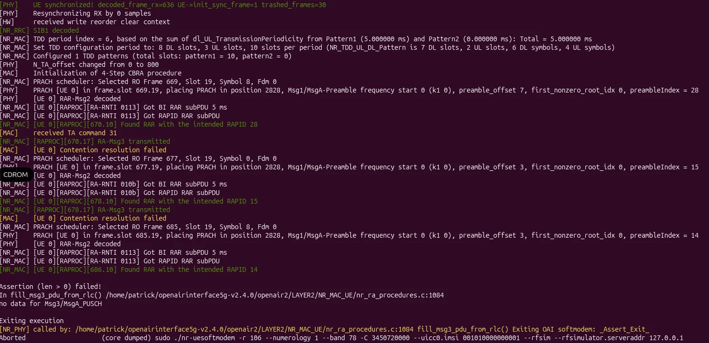
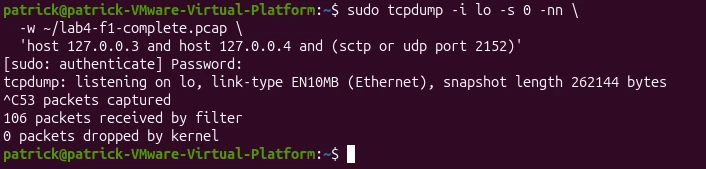
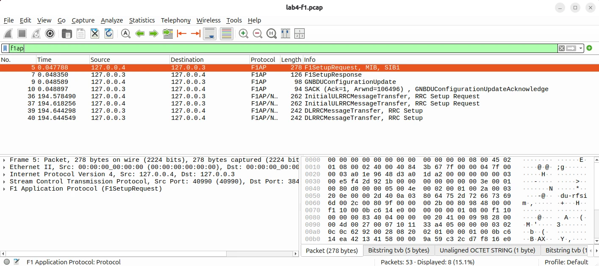
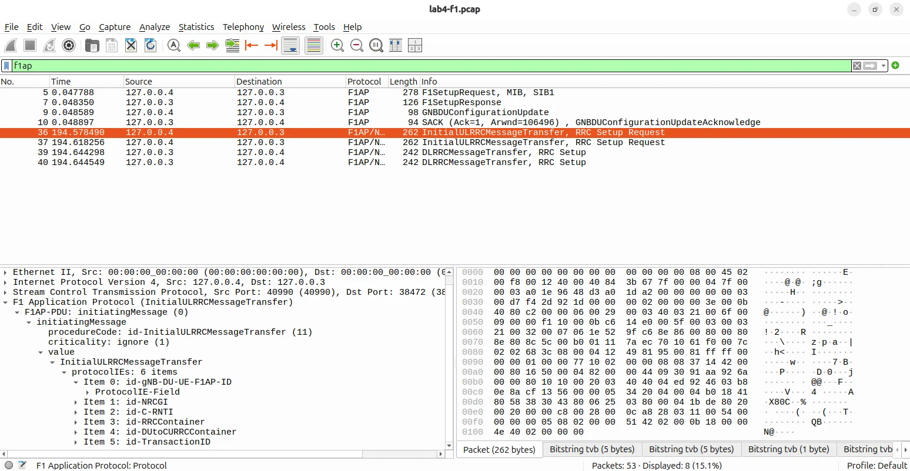
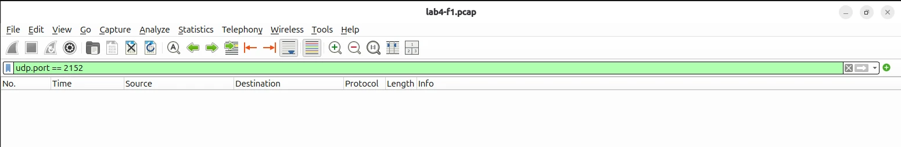

# Lab 4 — 5G CU/DU Split Deployment and F1-C/F1-U Analysis

**Environment:** Ubuntu 26.04.1 LTS · VMware Workstation · OpenAirInterface v2.4.0 · RFsimulator

## 1. Learning Objectives

After completing this lab, you should be able to:

1. Explain the functional division between gNB-CU and gNB-DU.
2. Deploy a split 5G SA RAN with OAI and RFsimulator.
3. Identify F1-C control-plane messages.
4. Identify F1-U GTP-U packets and their TEIDs.
5. Verify UE connectivity through the split architecture.
6. Distinguish F1-U from N3.

## 2. Network Architecture and Experimental Parameters

The experiment replaces the monolithic gNB from Lab 3 with separate Central Unit (CU) and Distributed Unit (DU) processes.

```text
                     OAI 5G Core
                   AMF / SMF / UPF
                          |
                   N2 / N3 Interface
                          |
                       gNB-CU
                     127.0.0.3
                     RRC / PDCP
                          |
                  F1-C / F1-U
                          |
                       gNB-DU
                     127.0.0.4
                    RLC / MAC / PHY
                          |
                      RFsimulator
                          |
                         nrUE
                          |
                     oaitun_ue1
                          |
                    External DN
```

### Experimental Configuration

| Parameter | Configuration |
|---|---|
| Operating system | Ubuntu 26.04.1 LTS |
| Virtualization | VMware Workstation |
| OAI version | v2.4.0 |
| RAN | gNB-CU + gNB-DU + nrUE |
| Radio interface | RFsimulator |
| NR band | n78 |
| Bandwidth | 106 PRBs |
| Numerology | 1 (30 kHz SCS) |
| CU F1 address | 127.0.0.3 |
| DU F1 address | 127.0.0.4 |
| DU SSB NR-ARFCN | 630048 |
| DU Point A | 628776 |
| UE frequency | 3450720000 Hz |
| UE IMSI | 001010000000001 |
| External DN | 192.168.70.135 |

The CU and DU use different configurations from the monolithic gNB in Lab 3. In particular, the DU uses an SSB frequency corresponding to 3450.72 MHz, requiring the UE frequency argument to be adjusted.

---

## 3. Task 1 — Inspect the Split Configurations

### Step 1 — Confirm Configuration Files

The following command was used to verify that both configuration files were available:

```bash
cd ~/openairinterface5g-v2.4.0

ls -l \
  targets/PROJECTS/GENERIC-NR-5GC/CONF/gnb-cu.sa.f1.conf \
  targets/PROJECTS/GENERIC-NR-5GC/CONF/gnb-du.sa.band78.106prb.rfsim.pci0.conf
```

Both files were found successfully.

### Step 2 — Verify Frequencies and Addresses

```bash
grep -nE \
'absoluteFrequencySSB|dl_absoluteFrequencyPointA|dl_carrierBandwidth|physCellId|local_s_address|remote_s_address|local_n_address|remote_n_address' \
targets/PROJECTS/GENERIC-NR-5GC/CONF/gnb-cu.sa.f1.conf \
targets/PROJECTS/GENERIC-NR-5GC/CONF/gnb-du.sa.band78.106prb.rfsim.pci0.conf
```

### Results

| Configuration Item | Observed Value |
|---|---|
| CU local F1 address | 127.0.0.3 |
| DU local F1 address | 127.0.0.4 |
| DU remote F1 address | 127.0.0.3 |
| SSB NR-ARFCN | 630048 |
| Point A | 628776 |
| Carrier bandwidth | 106 PRBs |


*Figure 1: Verification of CU/DU F1 addresses and DU radio configuration.*

### Questions

**1. Which protocol layers mainly reside in the CU, and which reside in the DU?**

The gNB-CU mainly handles higher-layer functions, including RRC, PDCP, and SDAP. The gNB-DU performs the lower-layer processing, including RLC, MAC, and PHY. This separation allows central control functions to operate independently of radio scheduling and physical-layer processing.

**2. What is the purpose of the F1 interface?**

The F1 interface connects the gNB-CU and gNB-DU. It consists of F1-C for control-plane signaling and F1-U for user-plane traffic. F1-C uses F1AP over SCTP, while F1-U transports user-plane data using GTP-U over UDP.

**3. Why must the UE radio frequency be compatible with the DU rather than taken blindly from the previous lab?**

The DU is responsible for transmitting the radio signals used by the UE for synchronization and communication. Therefore, the UE must use frequency parameters matching the DU configuration. Lab 3 used a different SSB frequency, so the earlier UE frequency argument could not simply be reused.

---

## 4. Task 2 — Deploy the Split 5G SA Network

### Step 1 — Start the 5G Core

The OAI 5G Core was started using:

```bash
cd ~/oai-cn5g
docker compose up -d
docker compose ps
```

All ten required containers were started successfully.


*Figure 2: OAI 5G Core Docker containers running.*

### Step 2 — Start gNB-CU

```bash
cd ~/openairinterface5g-v2.4.0/cmake_targets/ran_build/build

sudo ./nr-softmodem \
  -O ../../../targets/PROJECTS/GENERIC-NR-5GC/CONF/gnb-cu.sa.f1.conf
```

The CU established its NGAP connection to the AMF.

Relevant log messages included:

```text
[NGAP] Send NGSetupRequest to AMF
[NGAP] Received NGSetupResponse from AMF
[F1AP] Starting F1AP at CU
[F1AP] F1AP_CU_SCTP_REQ(create socket) for 127.0.0.3
[GTPU] Initializing UDP for local address 127.0.0.3 with port 2152
```

### Step 3 — Start gNB-DU

```bash
cd ~/openairinterface5g-v2.4.0/cmake_targets/ran_build/build

sudo ./nr-softmodem \
  -O ../../../targets/PROJECTS/GENERIC-NR-5GC/CONF/gnb-du.sa.band78.106prb.rfsim.pci0.conf \
  --rfsim
```

After starting the DU, the CU received the F1 Setup Request and sent the corresponding response.

The CU log contained:

```text
[NR_RRC] Received F1 Setup Request from gNB_DU 3584 (du-rfsim) on assoc_id 6
[NR_RRC] Accepting DU 3584 (du-rfsim), sending F1 Setup Response
[NR_RRC] DU uses RRC version 17.3.0
[NR_RRC] cell PLMN 001.01 Cell ID 12345678 is in service
```


*Figure 3: Successful F1 Setup between the CU and DU.*

### Step 4 — Start nrUE

```bash
cd ~/openairinterface5g-v2.4.0/cmake_targets/ran_build/build

sudo ./nr-uesoftmodem \
  -r 106 \
  --numerology 1 \
  --band 78 \
  -C 3450720000 \
  --uicc0.imsi 001010000000001 \
  --rfsim \
  --rfsimulator.serveraddr 127.0.0.1
```

The UE successfully synchronized with the DU and decoded SIB1. The Random Access procedure then began.

Relevant messages:

```text
UE synchronized!
SIB1 decoded
Initialization of 4-Step CBRA procedure
RAR-Msg2 decoded
Found RAR with the intended RAPID
RA-Msg3 transmitted
```

However, contention resolution failed during subsequent Random Access attempts.

The UE eventually terminated with:

```text
Assertion (len > 0) failed!
In fill_msg3_pdu_from_rlc()
no data for Msg3/MsgA_PUSCH
Aborted (core dumped)
```



*Figure 4: nrUE synchronization and Random Access failure.*

The DU and CU were successfully connected, and the UE reached the Random Access procedure. However, UE registration and PDU Session Establishment were not completed.

### End-to-End Connectivity

The expected connectivity commands were:

```bash
ip -4 addr show oaitun_ue1
ping -I oaitun_ue1 -c 10 192.168.70.135
```

Because the UE terminated during Random Access, the PDU Session was not established and no successful end-to-end ping was obtained.

| Measurement | Result |
|---|---|
| UE synchronization | Successful |
| SIB1 decoding | Successful |
| Random Access | Failed |
| UE registration | Not completed |
| PDU Session | Not established |
| UE tunnel IP | Not available |
| Ping packets transmitted | Not measured |
| Ping packets received | Not measured |
| Packet loss | Not measured |
| Average RTT | Not measured |

---

## 5. Task 3 — Capture F1-C and F1-U in a Single PCAP

### Packet Capture

Before starting the DU, a packet capture was started on the Linux loopback interface:

```bash
sudo tcpdump -i lo -s 0 -nn \
  -w ~/lab4-f1-complete.pcap \
  'host 127.0.0.3 and host 127.0.0.4 and (sctp or udp port 2152)'
```

This filter captures SCTP traffic for F1-C and UDP port 2152 traffic for F1-U between the configured CU and DU addresses.

After starting the DU and nrUE, the packet capture was stopped using `Ctrl+C`.

### Capture Results

| Parameter | Observed Value |
|---|---|
| Capture interface | lo |
| CU address | 127.0.0.3 |
| DU address | 127.0.0.4 |
| Capture file | lab4-f1-complete.pcap |
| Packets captured | 53 |
| Packets received by filter | 106 |
| Packets dropped by kernel | 0 |
| F1AP packets decoded | 8 |

The capture completed successfully without kernel packet drops.



*Figure 5: tcpdump capture statistics showing 53 captured packets and zero kernel drops.*

### SCTP Connection Establishment

The captured packets confirmed the SCTP association between the DU and CU.

| Message | Source | Destination |
|---|---|---|
| SCTP INIT | 127.0.0.4 | 127.0.0.3 |
| SCTP INIT ACK | 127.0.0.3 | 127.0.0.4 |
| SCTP COOKIE ECHO | 127.0.0.4 | 127.0.0.3 |
| SCTP COOKIE ACK | 127.0.0.3 | 127.0.0.4 |

The observed SCTP endpoints were:

- DU: `127.0.0.4:40990`
- CU: `127.0.0.3:38472`

The captured SCTP DATA packets used PPID `0x3e` (62), corresponding to F1AP.

---

## 6. Task 4 — Analyze F1-C (F1AP / SCTP)

The recorded PCAP was analyzed using Wireshark and TShark.

The following display filter was applied:

```text
f1ap
```

### F1AP Messages

Eight F1AP packets were identified.

| Packet | Source | Destination | F1AP Message |
|---|---|---|---|
| 5 | 127.0.0.4 | 127.0.0.3 | F1 Setup Request |
| 7 | 127.0.0.3 | 127.0.0.4 | F1 Setup Response |
| 9 | 127.0.0.4 | 127.0.0.3 | GNBDU Configuration Update |
| 10 | 127.0.0.3 | 127.0.0.4 | GNBDU Configuration Update Acknowledge |
| 36 | 127.0.0.4 | 127.0.0.3 | Initial UL RRC Message Transfer |
| 37 | 127.0.0.4 | 127.0.0.3 | Initial UL RRC Message Transfer |
| 39 | 127.0.0.3 | 127.0.0.4 | DL RRC Message Transfer |
| 40 | 127.0.0.3 | 127.0.0.4 | DL RRC Message Transfer |

### F1 Setup Procedure

Packet 5 contains the F1 Setup Request sent by the DU to the CU.

Packet 7 contains the F1 Setup Response sent by the CU to the DU.

This confirms successful F1 interface establishment.



*Figure 6: F1 Setup Request and Response in Wireshark, packets 5 and 7.*

### RRC Signaling Over F1-C

The capture also contained UE-related RRC signaling.

Packets 36 and 37 carried Initial UL RRC Message Transfer messages from the DU to the CU, containing RRC Setup Requests.

Packets 39 and 40 carried DL RRC Message Transfer messages from the CU to the DU, containing RRC Setup messages.

Detailed inspection of packet 36 showed:

| Field | Value |
|---|---|
| Packet number | 36 |
| Source | 127.0.0.4 |
| Destination | 127.0.0.3 |
| F1AP message | InitialULRRCMessageTransfer |
| Procedure code | 11 |
| RRC message | RRC Setup Request |
| Protocol IEs | 6 |
| Transport | SCTP |

The protocol information elements included:

- gNB-DU UE F1AP ID
- NRCGI
- C-RNTI
- RRC Container
- DUtoCURRCContainer
- Transaction ID



*Figure 7: Initial UL RRC Message Transfer in packet 36, showing the F1AP information elements.*

### Questions

**1. Which node initiates F1 Setup, and which acknowledges it?**

The gNB-DU initiates F1 Setup by sending an F1 Setup Request to the gNB-CU. The CU processes the request and returns an F1 Setup Response. This behavior was confirmed by packets 5 and 7 of the capture.

**2. Explain the difference between SCTP association establishment and F1 Setup.**

SCTP association establishment creates the transport connection between the CU and DU. It involves SCTP INIT, INIT ACK, COOKIE ECHO, and COOKIE ACK messages. F1 Setup occurs afterward at the application layer and exchanges F1AP configuration information between the two network entities. Therefore, a functioning SCTP association alone does not guarantee successful F1 Setup.

**3. How can a NAS Registration Request be transported over F1-C?**

The UE sends a NAS Registration Request encapsulated in an RRC message. The DU forwards the RRC message to the CU using F1AP over the F1-C interface. The CU then processes the RRC information and forwards the NAS signaling toward the AMF over the NGAP interface.

**4. What is the role of UE Context Setup?**

UE Context Setup establishes UE-specific resources and configuration between the CU and DU. These can include radio bearers, identifiers, and user-plane tunnel information. The procedure allows the DU to handle the UE's lower-layer processing according to the configuration determined by the CU.

**5. Does F1 Setup alone prove successful UE Registration? Explain.**

No. F1 Setup only confirms that the CU and DU have successfully established their internal interface. UE Registration requires additional radio procedures, RRC signaling, NAS authentication, and communication with the 5G Core. In this experiment, F1 Setup succeeded, but the UE did not complete registration because Random Access failed.

---

## 7. Task 5 — Analyze F1-U (GTP-U / UDP)

The same PCAP was inspected for F1-U traffic using the following Wireshark filters:

```text
gtp
```

and:

```text
udp.port == 2152
```

No matching packets were displayed.



*Figure 8: Wireshark filter showing no UDP port 2152 packets in the recorded capture.*

### Results

| Parameter | Observation |
|---|---|
| F1-U transport | GTP-U over UDP |
| Expected UDP port | 2152 |
| CU address | 127.0.0.3 |
| DU address | 127.0.0.4 |
| GTP-U T-PDUs captured | 0 |
| TEID | Not available |
| UL packet count | 0 in captured F1-U traffic |
| DL packet count | 0 in captured F1-U traffic |

The recorded traffic contained F1-C signaling but no F1-U packets matching the capture filter.

The nrUE terminated during Random Access, preventing successful registration and PDU Session Establishment. Consequently, no regular UE user-plane traffic was generated through F1-U.

### Questions

**1. Which transport protocol carries F1-U?**

F1-U uses GTP-U over UDP. GTP-U encapsulates user-plane packets and transports them between the gNB-CU and gNB-DU.

**2. What does a GTP-U TEID identify?**

The Tunnel Endpoint Identifier (TEID) identifies a particular GTP-U tunnel endpoint. It allows the receiving network entity to associate incoming GTP-U packets with the appropriate bearer or user-plane context.

**3. Which direction is 127.0.0.4 → 127.0.0.3 in this setup?**

The address `127.0.0.4` belongs to the gNB-DU, while `127.0.0.3` belongs to the gNB-CU. Therefore, traffic from `127.0.0.4` to `127.0.0.3` travels from the DU toward the CU and represents the uplink direction for F1-U user-plane traffic.

**4. How would you distinguish F1-U from N3 in a packet capture?**

Both F1-U and N3 use GTP-U, so the protocol alone is not sufficient to identify the interface. F1-U carries traffic between the gNB-DU and gNB-CU, whereas N3 connects the gNB-CU to the UPF. The interface can therefore be identified by checking the actual source and destination IP addresses and comparing them with the network configuration.

**5. Why do F1-C and F1-U use different transport protocols?**

F1-C carries control-plane signaling using F1AP over SCTP, which supports reliable message delivery and association management. F1-U carries user-plane data using GTP-U over UDP to provide efficient packet encapsulation and forwarding. The different transport protocols reflect the different requirements of control signaling and user-data transmission.

---

## 8. Task 6 — Compare Monolithic and Split gNB

| Feature | Lab 3: Monolithic gNB | Lab 4: CU/DU Split |
|---|---|---|
| Number of RAN processes | One gNB process | Separate CU and DU processes |
| Location of RRC/PDCP | Monolithic gNB | gNB-CU |
| Location of RLC/MAC/PHY | Monolithic gNB | gNB-DU |
| F1-C interface present? | No | Yes |
| F1-U interface present? | No | Configured, but no user-plane traffic captured |
| UE connected to the same 5GC? | Same OAI CN5G configuration | Same OAI CN5G configuration |
| End-to-end Ping works? | Not verified in Lab 3 | Not verified in Lab 4 |

### Analysis

Splitting the gNB separates higher-layer control processing from lower-layer radio processing. The CU handles functions such as RRC and PDCP, while the DU handles RLC, MAC, and PHY. Communication between these components requires the F1-C and F1-U interfaces, which are not present in the monolithic architecture. However, the UE still requires synchronization, successful registration, and PDU Session Establishment before user-plane data can be exchanged. The split architecture changes the internal organization of the RAN but does not eliminate the standard 5G connection procedures.

---

## 9. Troubleshooting

Several issues were encountered during the deployment and analysis.

### UE Random Access Failure

The UE successfully synchronized with the DU and decoded SIB1, but contention resolution failed during the Random Access procedure.

The final error was:

```text
Assertion (len > 0) failed!
In fill_msg3_pdu_from_rlc()
no data for Msg3/MsgA_PUSCH
Aborted (core dumped)
```

This indicates that the UE could not provide the required data for the Msg3 transmission during Random Access. Possible contributing factors include timing problems, software processing limitations, or compatibility issues in the virtualized environment. The available logs do not establish a definitive root cause.

### PCAP File Permission Issue

TShark initially reported:

```text
You don't have permission to read the file
```

The PCAP was confirmed to be readable using tcpdump. The issue was bypassed by sending the capture through standard input:

```bash
cat ~/lab4-f1-complete.pcap | tshark -r - -Y f1ap
```

This successfully displayed the eight decoded F1AP packets.

### Missing F1-U Traffic

The capture contained SCTP and F1AP signaling but no UDP port 2152 traffic between the CU and DU.

Because the UE did not establish a PDU Session, the expected user-plane traffic was not generated. Therefore, the F1-U TEID and T-PDU fields could not be analyzed.

---

## 10. Submission Checklist

| Requirement | Status |
|---|---|
| CU/DU configuration summary | Completed |
| CU and DU running | Completed |
| F1 Setup Request/Response | Completed |
| SCTP association analysis | Completed |
| RRC signaling over F1-C | Partially completed |
| UE tunnel and successful Ping | Not completed |
| PCAP containing F1-C | Completed |
| PCAP containing F1-U | Not completed |
| GTP-U T-PDU and TEID analysis | Not completed |
| F1-C vs F1-U vs N3 explanation | Completed |
| Monolithic vs split comparison | Completed |
| Troubleshooting analysis | Completed |

The experiment successfully demonstrated CU/DU deployment, SCTP association establishment, F1 Setup, and initial RRC signaling over F1-C.

However, the nrUE failed during Random Access, preventing UE Registration, PDU Session Establishment, and F1-U user-plane analysis.

The PCAP file `lab4-f1-complete.pcap` contains 53 captured packets and provides evidence of the successful F1-C signaling procedures.

---

## 11. Grading Rubric

| Category | Points |
|---|---:|
| Correct CU/DU deployment and parameter verification | 20 |
| F1-C capture and F1 Setup analysis | 20 |
| RRC/UE Context messages over F1-C | 20 |
| F1-U GTP-U and TEID analysis | 20 |
| UE tunnel and end-to-end Ping | 10 |
| Monolithic vs split comparison and report quality | 10 |
| **Total** | **100** |

---

## 12. Stop the Experiment

The nrUE, DU, and CU processes can be stopped using `Ctrl+C`.

The 5G Core can then be stopped using:

```bash
cd ~/oai-cn5g
docker compose down
```

## Conclusion

The OAI v2.4.0 CU/DU split architecture was successfully deployed using RFsimulator. The CU established an NGAP connection with the AMF, and the DU successfully completed F1 Setup with the CU. SCTP association establishment and F1AP signaling were captured and analyzed, including F1 Setup, DU Configuration Update, and initial RRC message transfers.

The UE synchronized with the DU but failed during Random Access, so PDU Session Establishment and end-to-end connectivity could not be completed. As a result, the capture provided valid F1-C evidence but no F1-U user-plane traffic.

The experiment demonstrates the separation of control and user-plane functionality in the split architecture and highlights the importance of completing UE registration before analyzing F1-U data transmission.
