# Lab 5: From Initial Access to RRC Connection Setup (Student Guide)

## 1. Lab Goal

In Lab 1, you observed UE registration with the 5GC and the establishment of data service. This lab moves the observation point earlier: before registering with the Core network, how does a UE find a gNB, obtain cell system information, perform Random Access, and finally establish an RRC connection?

The main procedure in this lab is:

```text
Cell search / initial synchronization
→ MIB / SIB1
→ Msg1 PRACH
→ Msg2 RAR
→ Msg3 RRCSetupRequest
→ Msg4 RRCSetup
→ RRCSetupComplete
→ RRC_CONNECTED
```

This lab ends at `RRC_CONNECTED`. NAS Registration, Authentication, and PDU Session establishment belong to the Core network scope covered in Lab 1.

## 2. Evidence Used in This Lab

You will receive three files produced by the same successful OAI run:

| File | Purpose |
|---|---|
| `Lab5-ue.log` | Observe UE cell search, synchronization, PRACH, and RRC state. |
| `Lab5-gnb.log` | Cross-check gNB-side behavior when needed. |
| `Lab5.pcap` | Use Wireshark to observe MIB, SIB1, RAR, and RRC messages. |

You are not required to start OAI for this lab. Your main task is to reconstruct and explain the access procedure using the supplied log and PCAP files. Section 7 provides optional steps for reproducing the files yourself.

## 3. Learning Objectives

After completing this lab, you should be able to:

1. Explain the UE procedure from Cell Search to `RRC_CONNECTED` in the correct order.
2. Distinguish the roles of broadcast system information, Random Access, and RRC Connection Setup.
3. Obtain complementary evidence from a UE log and a Wireshark MAC-NR trace.
4. Explain the meaning of `RRC_CONNECTED` and how it differs from 5GC Registration.

## 4. Open the Supplied Files

Perform all analysis from the `openairinterface5g` repository root. Put the three supplied files in `lab5-artifacts/`, or in another location of your choice. If you use another location, adjust the paths in the commands accordingly.

```text
lab5-artifacts/Lab5-ue.log
lab5-artifacts/Lab5-gnb.log
lab5-artifacts/Lab5.pcap
```

Open `lab5-artifacts/Lab5.pcap` in Wireshark.

If Wireshark shows only UDP packets or the `nr-rrc` filter does not work, complete the following setup once:

1. Open **Analyze → Enabled Protocols...**, search for, and enable `MAC-NR-FRAMED`.
2. Open **Preferences → Protocols → MAC-NR** and enable NR RRC decoding for BCCH/CCCH data.
3. Open **Preferences → Protocols → RLC-NR** and enable RRC decoding for CCCH data and AM reassembly.
4. Close and reopen the PCAP.

## 5. Submission and Grading

Add a brief explanation below every screenshot. You do not need to draw boxes or arrows on screenshots.

### Task 1: From Cell Search to Msg2 RAR — 35 points

Complete the following four steps in order. For each step, provide the requested values or screenshots and briefly explain what the evidence shows and why it matters in the access procedure.

#### Step 1: Find Cell Search and Initial Synchronization — 8 points

Run the following command on `Lab5-ue.log`:

```bash
grep -nE 'Starting cell search|Initial sync successful' lab5-artifacts/Lab5-ue.log
```

Record whether UE synchronization succeeded and the PCI value. Explain: after completing initial synchronization, what is the UE able to do?

**Student result — Task 1 / Step 1**

```text
56: Starting cell search with center freq: 3619200000, bandwidth: 106.
63: Initial sync successful, PCI: 0
```

**Synchronization:** Successful. **PCI:** `0`. After initial synchronization the UE has established the cell's timing/frequency reference and can decode the PBCH/MIB and obtain further broadcast system information such as SIB1. Synchronization alone is not an RRC connection or 5GC registration. The log also confirms `SIB1 decoded` at line 71.

#### Step 2: Find MIB and SIB1 — 8 points

In Wireshark, enter:

```text
nr-rrc
```

Find one `MIB` packet and one `SIB1` packet. Record the frame number of each and provide screenshots.

MIB and SIB1 are repeatedly broadcast system-information messages. The UE must obtain the common configuration before it can continue the access procedure. Briefly explain the purpose of MIB and SIB1 for UE access.

**Student result — Task 1 / Step 2**

| Message | Wireshark frame | Observed transport |
|---|---:|---|
| MIB | **2** | BCH (BCCH-BCH-Message) |
| SIB1 | **1** | DL-SCH (BCCH-DL-SCH-Message) |

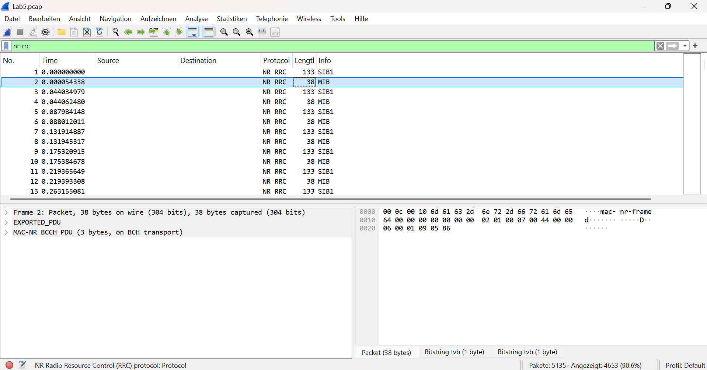

*Figure 1: Wireshark `nr-rrc` filter showing repeated MIB and SIB1 packets. Frame numbers 2 (MIB) and 1 (SIB1) were selected for analysis.*

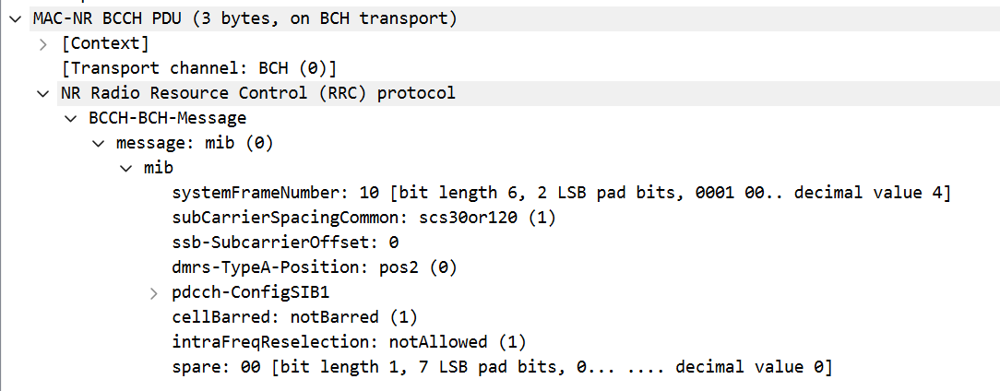

*Figure 2: Decoded MIB in frame 2, including `subCarrierSpacingCommon: scs30or120`, `ssb-SubcarrierOffset: 0` and `cellBarred: notBarred`.*

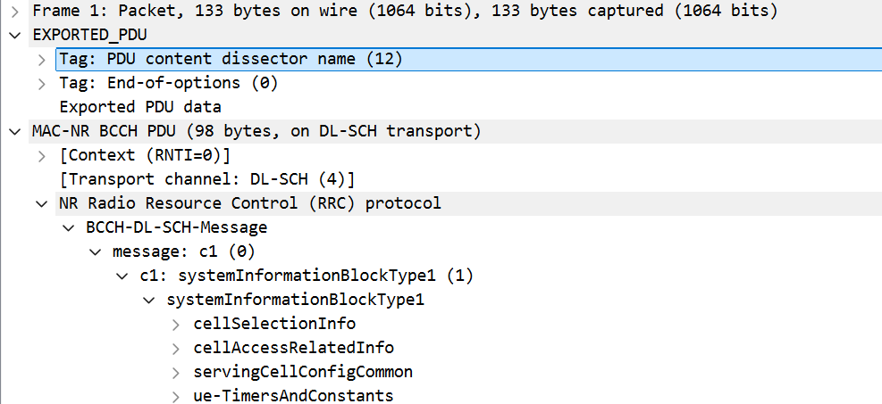

*Figure 3: Decoded SIB1 in frame 1, including `cellSelectionInfo`, `cellAccessRelatedInfo`, `servingCellConfigCommon`, and `ue-TimersAndConstants`.*

**Explanation:** The MIB provides essential parameters for obtaining further system information, including common subcarrier spacing and information necessary for SIB1 acquisition. SIB1 provides cell access, selection, and common serving-cell configuration, including information needed for initiating Random Access. Both are broadcast repeatedly; their order in the saved capture does not have to reflect the UE's first successful reception.

#### Step 3: Find Msg1 PRACH — 8 points

Run the following command on the UE log:

```bash
grep -nE 'PRACH' lab5-artifacts/Lab5-ue.log
```

Record the Msg1 log line number. From the line that shows the actual PRACH transmission, find:

```text
frame.slot = 553.19
preambleIndex = 16
```

Next, return to Wireshark. Clear the display filter, press `Cmd/Ctrl + F`, choose **Packet details** as the search scope, and search for:

```text
RACH Preamble chosen
```

After locating the PRACH event recorded by the gNB tracer, record:

```text
RAPID = 16
```

This packet is displayed as `MAC-LTE RACH Preamble chosen`; it is the OAI tracer MAC-event format.

Submit one UE-log screenshot and one Wireshark screenshot. Briefly answer:

1. Which Random Access message is this PRACH transmission?
2. At which `frame.slot` and with which `preambleIndex` does the UE log show transmission?
3. Does the Wireshark `RAPID` match the UE-log `preambleIndex`? What does this show?

**Student result — Task 1 / Step 3**

| Measurement | Observed value |
|---|---|
| UE log line for actual PRACH transmission | **81** |
| UE `frame.slot` | **553.19** |
| UE `preambleIndex` | **16** |
| gNB tracer Wireshark frame | **489** |
| Wireshark `RAPID` | **16** |
| Tracer attempt | **0** |

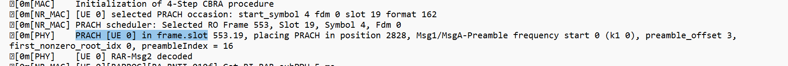

*Figure 4: UE log line 81 showing PRACH transmission at frame.slot 553.19 with preambleIndex 16.*

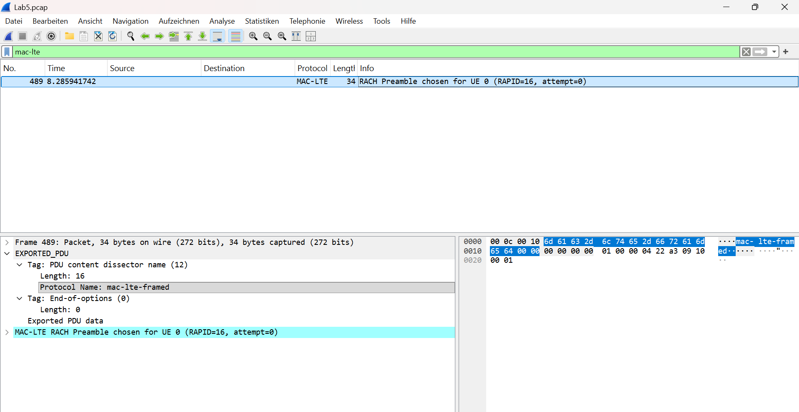

*Figure 5: MAC-LTE OAI tracer event at Wireshark frame 489, reporting RAPID 16 and attempt 0.*

**Answers — Task 1 / Step 3**

1. This PRACH transmission is **Msg1**, the Random Access preamble in the four-step contention-based Random Access procedure.
2. The UE log records transmission at **frame.slot `553.19`** using **preambleIndex `16`** (line 81).
3. **Yes.** Wireshark reports **RAPID `16`** in frame 489, matching the UE log's preambleIndex `16`. This correlates the UE's selected preamble with the event recorded by the gNB tracer.

#### Step 4: Find Msg2 RAR in Wireshark — 11 points

Return to Wireshark and clear the display filter. Press `Cmd/Ctrl + F`, choose **Packet details** as the search scope, and search for `RAR` or `Random Access Response`. After locating the packet, record its frame number and find the following values in `MAC-NR RAR`:

```text
RAPID = 16
Temporary C-RNTI = 61982 (0xF21E)
```

**Student result — Task 1 / Step 4**

| Field | Observed value |
|---|---|
| Wireshark frame | **490** |
| Message | Msg2 — MAC-NR RAR |
| RAPID | **16** |
| Temporary C-RNTI | **61982** (`0xF21E`) |
| RA-RNTI | 271 |
| Timing Advance (TA) | 0 |

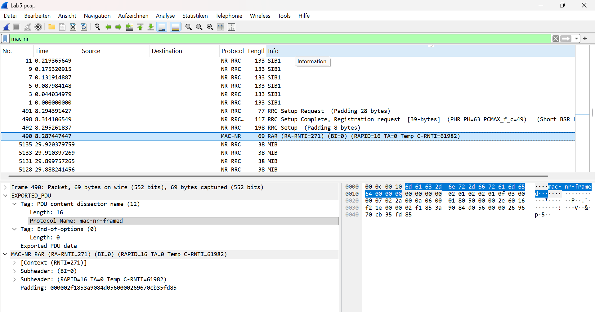

*Figure 6: MAC-NR RAR in frame 490, showing RAPID 16 and Temporary C-RNTI 61982.*

**Explanation:** Msg2 acknowledges the selected PRACH preamble, assigns a Temporary C-RNTI, and provides timing advance and an uplink grant so that the UE can transmit Msg3. RAPID 16 agrees with Msg1.

### Task 2: Complete Random Access and RRC Connection Setup — 40 points

Complete the following steps in order. For each message, provide a screenshot and record the requested frame number, fields, and brief explanation.

#### Step 1: Find RRCSetupRequest — 10 points

In Wireshark, use:

```text
nr-rrc.rrcSetupRequest_element
```

Expand `UL-CCCH-Message → rrcSetupRequest` and find:

```text
Frame number = 491
Context RNTI = 61982 (0xF21E)
```

Briefly answer:

1. Does the `Context RNTI` match the `Temporary C-RNTI` in the Task 1 / Step 4 RAR? What does this show?
2. Can you claim that the RRC connection has been established after seeing only `RRCSetupRequest`? Why or why not?

**Student result — Task 2 / Step 1**

| Field | Observed value |
|---|---|
| Wireshark frame | **491** |
| Message | RRCSetupRequest (Msg3) |
| Context RNTI | **61982** (`0xF21E`) |
| Channel | UL-CCCH over MAC-NR UL-SCH |
| Establishment cause | `mo-Signalling` |

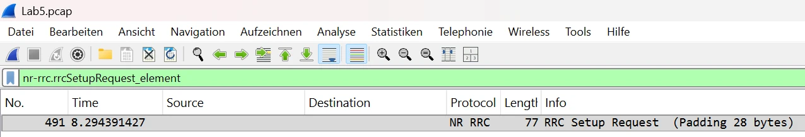

*Figure 7: Wireshark frame 491 identified as RRC Setup Request.*

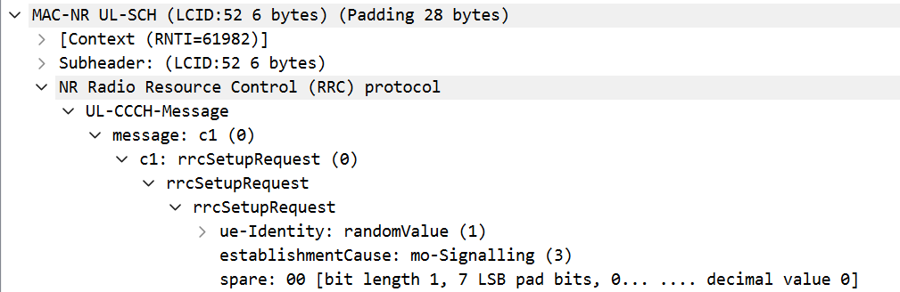

*Figure 8: RRCSetupRequest details showing Context RNTI 61982 and establishment cause `mo-Signalling`.*

**Answers:**

1. **Yes.** The Context RNTI `61982` matches the Temporary C-RNTI `61982` from the Msg2 RAR. The UE uses the temporary identifier assigned during Random Access.
2. **No.** RRCSetupRequest only requests an RRC connection. The gNB must respond with RRCSetup, and the UE must subsequently complete the procedure with RRCSetupComplete.

#### Step 2: Find RRCSetup — 10 points

Clear the previous filter and enter:

```text
nr-rrc.rrcSetup_element
```

Expand `DL-CCCH-Message → rrcSetup` and find:

```text
Frame number = 492
Context RNTI = 61982 (0xF21E)
rrc-TransactionIdentifier = 1
```

Check whether `Contention Resolution` also appears in the packet.

Below the screenshot, briefly answer:

1. Which message is this in four-step Random Access?
2. What does it mean that `Contention Resolution` and `RRCSetup` appear in the same downlink message?

**Student result — Task 2 / Step 2**

| Field | Observed value |
|---|---|
| Wireshark frame | **492** |
| Message | RRCSetup (Msg4) |
| Context RNTI | **61982** (`0xF21E`) |
| `rrc-TransactionIdentifier` | **1** |
| MAC Contention Resolution | **Present** |

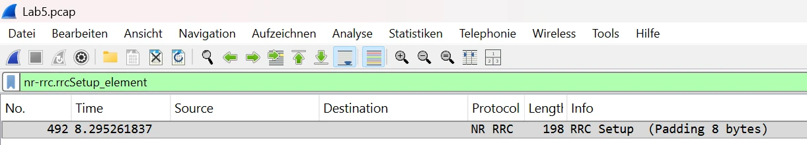

*Figure 9: Wireshark frame 492 identified as RRC Setup.*

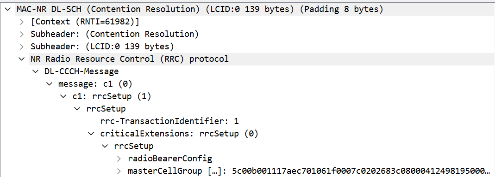

*Figure 10: RRCSetup with Transaction Identifier 1 and a MAC Contention Resolution subheader in the same downlink packet.*

**Answers:**

1. This is **Msg4**, the contention-resolution message of four-step Random Access, carrying the RRCSetup message toward the UE.
2. The gNB combines contention resolution with the RRCSetup downlink transmission. The UE can resolve contention and receive the configuration needed for RRC connection establishment in the same MAC transport block.

#### Step 3: Find RRCSetupComplete — 12 points

Clear the previous filter and enter:

```text
nr-rrc.rrcSetupComplete_element
```

Select the packet and first verify that `MAC-NR UL-SCH` appears at the top. Expand:

```text
RLC-NR → PDCP-NR → NR Radio Resource Control (RRC) protocol
  → UL-DCCH-Message → message: c1
```

Expand `message: c1` further and confirm that it contains `rrcSetupComplete`. Record:

```text
Frame number = 498
Context RNTI = 61982 (0xF21E)
rrc-TransactionIdentifier = 1
```

Below the screenshot, briefly answer:

1. Does the `Context RNTI` still match the `Temporary C-RNTI` in the RAR?
2. Does the `rrc-TransactionIdentifier` match the `RRCSetup` in Step 2? What is the purpose of this comparison?

**Student result — Task 2 / Step 3**

| Field | Observed value |
|---|---|
| Wireshark frame | **498** |
| Message | RRCSetupComplete |
| Context RNTI | **61982** (`0xF21E`) |
| `rrc-TransactionIdentifier` | **1** |
| Uplink stack | MAC-NR UL-SCH → RLC-NR → PDCP-NR → RRC UL-DCCH |

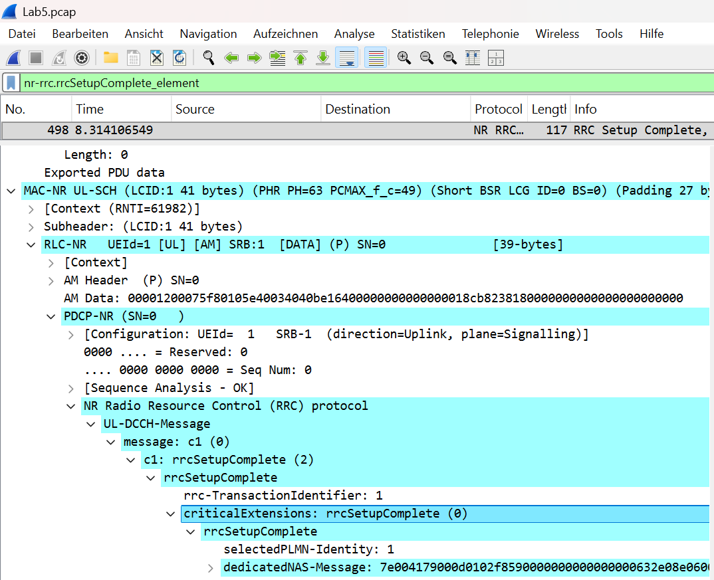

*Figure 11: Wireshark frame 498 showing RRCSetupComplete over MAC-NR UL-SCH, RLC-NR and PDCP-NR, with Context RNTI 61982 and Transaction Identifier 1.*

**Answers:**

1. **Yes.** RNTI `61982` is the same as the Temporary C-RNTI reported in Msg2, associating the completion message with the same UE.
2. **Yes.** Both RRCSetup (frame 492) and RRCSetupComplete (frame 498) use Transaction Identifier **1**. The matching identifier associates the response with the correct RRC transaction.

#### Step 4: Confirm the Final Random Access and RRC Connection Result — 8 points

Run the following command on the UE log:

```bash
grep -nE '4-Step RA procedure succeeded|Received NR_RRCSetup|RRCSetupComplete|State = NR_RRC_CONNECTED' \
  lab5-artifacts/Lab5-ue.log
```

From the output, record:

```text
4-Step RA procedure succeeded: line 87
Received NR_RRCSetup: line 88
State = NR_RRC_CONNECTED: line 90
Generating RRCSetupComplete: line 93
```

Submit a screenshot of this log output and briefly answer:

1. In log order, what are the three events from successful Random Access to generating `RRCSetupComplete`?
2. What do `4-Step RA procedure succeeded` and `State = NR_RRC_CONNECTED` each prove?

**Student result — Task 2 / Step 4**

```text
87: 4-Step RA procedure succeeded. CBRA: Contention Resolution is successful.
88: Received NR_RRCSetup
90: State = NR_RRC_CONNECTED
93: Generating RRCSetupComplete (bytes33)
```

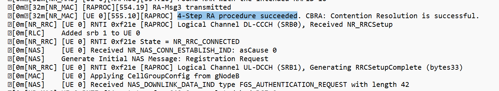

*Figure 12: UE log showing successful contention resolution, reception of RRCSetup, the state change to NR_RRC_CONNECTED, and generation of RRCSetupComplete.*

**Answers:**

1. The log reports three major stages in order: **(i)** successful four-step Random Access, **(ii)** reception of RRCSetup and transition to `NR_RRC_CONNECTED`, and **(iii)** generation of RRCSetupComplete. The precise event order in the log is lines 87, 88, 90, and 93.
2. `4-Step RA procedure succeeded` proves successful Random Access and MAC contention resolution. `State = NR_RRC_CONNECTED` proves that the UE's RRC state machine entered RRC_CONNECTED. It does **not** by itself demonstrate NAS registration or PDU Session Establishment.

### Task 3: Draw an Initial Access MSC Diagram — 25 points

Using the log and Wireshark evidence found in Tasks 1 and 2, draw your own Message Sequence Chart (MSC). It must include two vertical lifelines, `UE` and `gNB`, and the following six messages: MIB/SIB1, Msg1, Msg2, Msg3, Msg4, and `RRCSetupComplete`.

Determine and draw the correct order and direction of the messages yourself. Add a one-sentence purpose next to each arrow.

**Student result — Task 3 / Initial Access MSC**

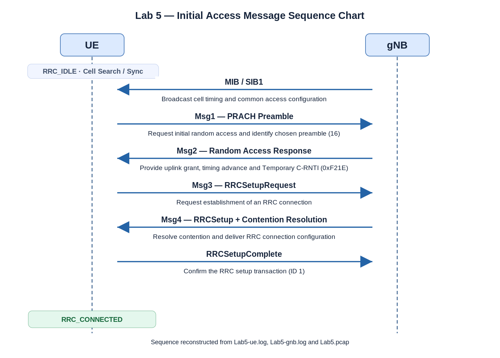

*Figure 13: Initial Access Message Sequence Chart reconstructed from the UE/gNB logs and the Wireshark trace. The two lifelines are UE and gNB; each arrow identifies the direction and purpose of one required message.*

**Sequence and purpose:**

| Order | Message | Direction | Purpose | Evidence |
|---:|---|---|---|---|
| 1 | MIB / SIB1 | gNB → UE | Broadcast essential cell and access configuration. | PCAP frames 2 / 1 |
| 2 | Msg1 PRACH | UE → gNB | Send a contention-based Random Access preamble. | UE log line 81; trace frame 489 |
| 3 | Msg2 RAR | gNB → UE | Provide the uplink grant, timing advance and temporary identifier. | Frame 490 |
| 4 | Msg3 RRCSetupRequest | UE → gNB | Request an RRC connection. | Frame 491 |
| 5 | Msg4 RRCSetup + Contention Resolution | gNB → UE | Resolve contention and provide RRC configuration. | Frame 492 |
| 6 | RRCSetupComplete | UE → gNB | Confirm RRC setup with matching transaction ID. | Frame 498 |

**State transition:** The UE starts in `RRC_IDLE` during initial access and reaches `RRC_CONNECTED` after the RRC setup procedure. The log explicitly reports the connected state at line 90. This RRC state does not itself prove completion of 5GC NAS registration.

| Item | Points |
|---|---:|
| UE and gNB lifelines, with the two UE states identified | 5 |
| Complete message order: MIB/SIB1, Msg1, Msg2, Msg3, Msg4, RRCSetupComplete | 12 |
| Correct direction for every message arrow | 5 |
| Reasonable brief purpose for every major stage | 3 |
| **Task 3 subtotal** | **25** |

| Item | Points |
|---|---:|
| Task 1: Initial Access evidence timeline | 35 |
| Task 2: Key-message analysis | 40 |
| Task 3: Initial Access MSC diagram | 25 |
| **Total** | **100** |

## 7. Optional: Reproduce the Log and PCAP Files

This section is not required for the assignment. If you want to generate the same kind of evidence using your own OAI run, follow these steps in an OAI/5GC environment that was already set up in an earlier class.

The commands below assume that you are currently in the `openairinterface5g` repository root. Use three terminals and first create a directory for the artifacts:

```bash
mkdir -p lab5-artifacts
```

### Terminal A: Start the gNB and Wait for the Tracer

```bash
cd cmake_targets/ran_build/build

sudo -E env RFSIMULATOR=server ./nr-softmodem \
  -O ../../../ci-scripts/conf_files/gnb.sa.band78.106prb.rfsim.conf \
  --rfsim --T_stdout 2 \
  2>&1 | tee ../../../lab5-artifacts/Lab5-gnb.log
```

### Terminal B: Record the gNB MAC/RRC Trace

```bash
cd cmake_targets/ran_build/build

./common/utils/T/tracer/record \
  -d ../../../common/utils/T/T_messages.txt \
  -o ../../../lab5-artifacts/Lab5-gnb-wireshark.raw \
  -on WIRESHARK
```

The gNB in Terminal A continues after the tracer connects.

### Terminal C: Start the UE and Save the UE Log

```bash
cd cmake_targets/ran_build/build

sudo -E RFSIMULATOR=127.0.0.1 ./nr-uesoftmodem \
  -O ../../../targets/PROJECTS/GENERIC-NR-5GC/CONF/ue.conf \
  --rfsim -r 106 --numerology 1 --band 78 -C 3619200000 \
  2>&1 | tee ../../../lab5-artifacts/Lab5-ue.log
```

After `State = NR_RRC_CONNECTED` appears, wait a few seconds, then stop the terminals in this order: recorder in Terminal B, UE in Terminal C, and gNB in Terminal A.

### Convert the Trace to a Wireshark PCAP

```bash
cd cmake_targets/ran_build/build

./common/utils/T/tracer/macpdu2wireshark \
  -d ../../../common/utils/T/T_messages.txt \
  -i ../../../lab5-artifacts/Lab5-gnb-wireshark.raw \
  -to-file ../../../lab5-artifacts/Lab5.pcap
```

You should obtain:

```text
lab5-artifacts/Lab5-ue.log
lab5-artifacts/Lab5-gnb.log
lab5-artifacts/Lab5.pcap
```
